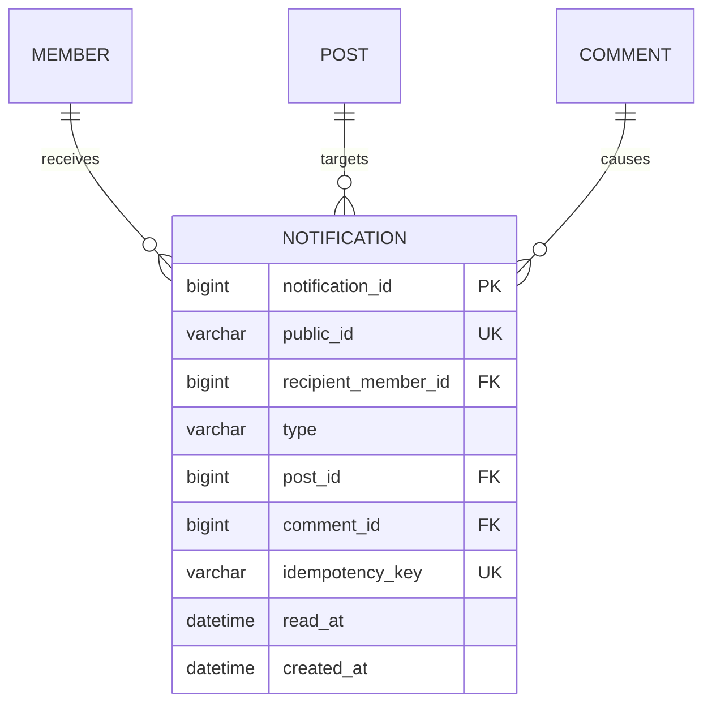

# 인앱 알림 ERD

## 1. 관계



`comment_id`는 베스트 알림에서만 `NULL`이다. 현재 알림 유형은 모두 게시글 화면으로 이동하므로 `post_id`는 `NOT NULL`이다.

## 2. 물리 테이블

```sql
CREATE TABLE notification (
    notification_id BIGINT NOT NULL AUTO_INCREMENT,
    public_id VARCHAR(36) NOT NULL,
    recipient_member_id BIGINT NOT NULL,
    type VARCHAR(30) NOT NULL,
    post_id BIGINT NOT NULL,
    comment_id BIGINT NULL,
    idempotency_key VARCHAR(150) NOT NULL,
    read_at DATETIME NULL,
    created_at DATETIME NOT NULL DEFAULT CURRENT_TIMESTAMP,
    PRIMARY KEY (notification_id),
    CONSTRAINT uk_notification_public_id UNIQUE (public_id),
    CONSTRAINT uk_notification_idempotency_key UNIQUE (idempotency_key),
    CONSTRAINT fk_notification_recipient
        FOREIGN KEY (recipient_member_id) REFERENCES member(member_id),
    CONSTRAINT fk_notification_post
        FOREIGN KEY (post_id) REFERENCES post(post_id),
    CONSTRAINT fk_notification_comment
        FOREIGN KEY (comment_id) REFERENCES comment(comment_id),
    CONSTRAINT chk_notification_comment_type CHECK (
        (type IN ('POST_COMMENT', 'COMMENT_REPLY') AND comment_id IS NOT NULL)
        OR (type = 'POST_BEST' AND comment_id IS NULL)
    )
);
```

실제 마이그레이션 작성 시 프로젝트의 MySQL 버전과 기존 명명 규칙에 맞춰 제약 이름을 최종 확인한다.

## 3. 인덱스

```sql
CREATE INDEX idx_notification_recipient_id_desc
    ON notification (recipient_member_id, notification_id DESC);

CREATE INDEX idx_notification_recipient_read_id
    ON notification (recipient_member_id, read_at, notification_id DESC);

CREATE INDEX idx_notification_retention
    ON notification (read_at, created_at);
```

- 목록 조회는 `(recipient_member_id, notification_id DESC)`를 사용한다.
- 미읽음 개수는 `(recipient_member_id, read_at, notification_id DESC)`에서 `read_at IS NULL` 범위를 사용한다.
- 정리 작업은 읽음 여부와 생성 시각을 기준으로 제한된 배치 삭제를 수행한다.

## 4. 삭제와 참조 정책

- `Post`와 `Comment`는 소프트 삭제하므로 알림 FK가 즉시 깨지지 않는다.
- 원본이 삭제·숨김·차단되면 알림 행은 유지하되 API에서 `targetAvailable=false`를 반환한다.
- 회원 탈퇴의 물리 삭제 정책이 추가되기 전까지 수신자 FK는 `RESTRICT`를 사용한다.
- 향후 회원 물리 삭제를 도입하면 알림 익명화 또는 수신자 기준 일괄 삭제 정책을 먼저 확정한다.

## 5. 마이그레이션

- 운영 마이그레이션 번호는 다음 순번인 `016_migration_notification.sql`을 사용한다.
- `database/ddl.sql`, JPA 엔티티, 운영 마이그레이션의 컬럼·인덱스·제약을 동일하게 유지한다.
- 배포 검증 스크립트에 테이블, FK, UNIQUE, CHECK, 복합 인덱스 존재 검증을 추가한다.
