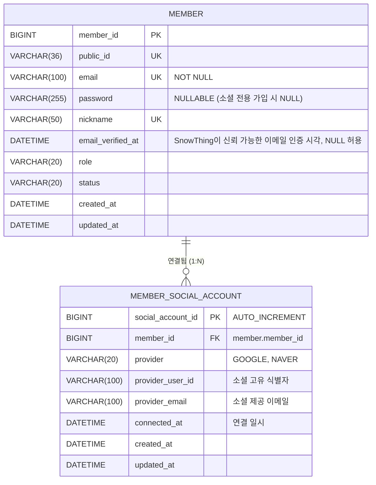

# 소셜 로그인 ERD 및 데이터베이스 마이그레이션

## 1. ERD 다이어그램

## 2. 테이블 상세 명세 (`member_social_account`)

| 컬럼명 | 타입 | 제약조건 | 설명 |
| :--- | :--- | :--- | :--- |
| `social_account_id` | `BIGINT` | `PK, AUTO_INCREMENT` | 소셜 계정 연결 PK |
| `member_id` | `BIGINT` | `FK (member.member_id), NOT NULL` | 회원 내부 PK (`ON DELETE CASCADE`) |
| `provider` | `VARCHAR(20)` | `NOT NULL` | `GOOGLE`, `NAVER` |
| `provider_user_id` | `VARCHAR(100)` | `NOT NULL` | 소셜 공급자 측 고유 사용자 ID |
| `provider_email` | `VARCHAR(100)` | `NOT NULL` | 연결 시점에 공급자가 제공한 이메일. 현재 소유권 보증 필드는 아님 |
| `connected_at` | `DATETIME` | `NOT NULL` | 연결 일시 |
| `created_at` | `DATETIME` | `NOT NULL, DEFAULT CURRENT_TIMESTAMP` | 생성 일시 |
| `updated_at` | `DATETIME` | `NOT NULL, DEFAULT CURRENT_TIMESTAMP ON UPDATE CURRENT_TIMESTAMP` | 수정 일시 |

## 3. 제약조건 및 인덱스

- `uk_member_social_provider_user`: `UNIQUE (provider, provider_user_id)` — 동일 소셜 계정의 중복 가입·타 계정 중복 연결 차단
- `uk_member_social_member_provider`: `UNIQUE (member_id, provider)` — 한 회원이 같은 소셜 공급자를 중복 연결하는 것 차단
- `chk_member_social_provider`: `CHECK (provider IN ('GOOGLE', 'NAVER'))`
- `fk_member_social_member`: `FOREIGN KEY (member_id) REFERENCES member (member_id) ON DELETE CASCADE`

`member.email` UNIQUE 제약은 한 이메일로 회원 행이 중복 생성되는 것을 막는다. 다만 이메일 충돌 시 기존 회원에 자동 연결하지 않고 `OAUTH_ACCOUNT_LINK_REQUIRED`로 종료한다.

## 4. 마이그레이션 파일

- `database/production/016_migration_social_login.sql`에 비파괴(`CREATE TABLE IF NOT EXISTS`) DDL을 정의하고 `scripts/verify-production-migration-007-015.sh`에서 스키마·인덱스·제약조건 무결성을 검증한다.
