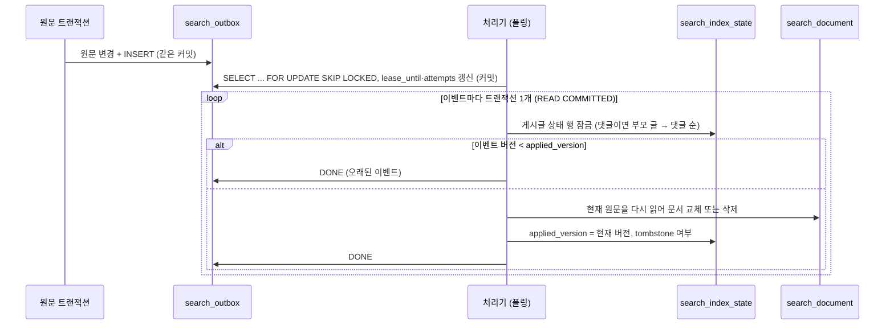

# 2단계 정합성: outbox 증분 색인, tombstone, 재시도, 대조, 무중단 재인덱싱

- 상태: 로컬 구현·검증 완료, 운영 미적용
- 기준일: 2026-11-04 (KST)
- Linear: IKA-10 (부모 IKA-5)
- 상위 설계: `01_design.md` D5, D6 (IKA-6 브랜치). 1단계 구현: `03_stage1_keyword_search.md` (IKA-7)

## 1. 범위

| 포함 | 제외 |
|---|---|
| `search_outbox`, `search_index_state`, `search_reindex_checkpoint` (028) | 의미 검색·재정렬 (IKA-11) |
| 게시글·댓글 변경과 같은 트랜잭션의 outbox 기록 | 세대(generation) 전환 방식 재인덱싱 (§7 참고) |
| 폴링 처리기: 현재 원문 재조회, 버전 비교, tombstone, 재시도·영구 실패 | ShedLock 같은 분산 스케줄 잠금 |
| 관리자 API: outbox 현황, 실패 재시도, 대조, 재인덱싱 | 운영 적용·배포 |
| 장애 테스트, 로컬 반영 지연 측정 | 운영 지연 측정 |

## 2. 스키마 (028_migration_search_outbox.sql)

### search_outbox

| 컬럼 | 설명 |
|---|---|
| event_id | PK, AUTO_INCREMENT |
| source_type, source_id | POST/COMMENT와 post_id/comment_id |
| operation | UPSERT/DELETE. 기록용이다. 처리기는 이 값을 믿지 않고 현재 원문을 다시 읽는다 |
| source_version | 이벤트를 쓴 시점의 `post.content_version` 또는 `comment.version` |
| status | PENDING, DONE, FAILED |
| attempts | 가져간 횟수. 가져갈 때 1 올린다 |
| created_at, due_at, lease_until, processed_at | DATETIME(6), KST (`Clock` 빈 기준) |
| last_error_code | 예외 클래스 이름(최대 100자). 예외 메시지는 저장하지 않는다 |

인덱스: `idx_search_outbox_status_due(status, due_at)` — 폴링 쿼리 `WHERE status='PENDING' AND due_at <= ? ORDER BY due_at, event_id`가 이 인덱스 순서(보조 인덱스 끝에 PK가 붙음)로 읽힌다. `idx_search_outbox_source(source_type, source_id)` — 대조가 "이미 PENDING인 원문"을 거를 때 쓴다.

### search_index_state

| 컬럼 | 설명 |
|---|---|
| (source_type, source_id) | PK |
| applied_version | 마지막으로 색인에 반영한 원문 버전. -1은 아직 반영 전 |
| tombstoned | true면 원문이 없거나 볼 수 없어 문서를 지운 상태 |
| document_count | 마지막 반영 때 넣은 이 원문 자신의 문서 수(게시글은 댓글 문서를 세지 않는다). 대조가 빠진 문서를 찾는 데 쓴다 |
| tombstoned_at | 처음 tombstone이 된 시각. 반영된 적 없이 tombstone인 행은 NULL |
| updated_at | 마지막 갱신 시각 |

- tombstone은 ID·버전·시각만 남긴다. 제목·본문은 남기지 않는다.
- 이 행은 같은 원문을 동시에 처리하지 못하게 하는 잠금 역할도 한다(§4).

### search_reindex_checkpoint

`job_name`(PK, 현재 `FULL` 하나), `status`(RUNNING/DONE), `last_source_id`(마지막으로 넣은 post_id), `enqueued_count`, `started_at`, `updated_at`, `finished_at`.

### 적용 순서와 호환성

- 새 테이블 3개만 만든다(`CREATE TABLE IF NOT EXISTS`). 두 번 실행해도 안전하다. 기존 테이블은 바꾸지 않는다.
- 새 앱은 `ddl-auto: validate`라서 028이 없으면 기동하지 못한다. 027과 같이 앱 배포보다 먼저 적용한다. 이전 앱 이미지는 새 테이블을 쓰지 않으므로 028 적용 후에도 그대로 동작한다.
- 이전 앱 이미지가 남아 있는 동안 생긴 변경은 outbox에 기록되지 않는다. 새 앱 배포 뒤 `POST /reconcile` 또는 `POST /reindex`를 한 번 실행한다.

## 3. outbox 기록 (원문 변경과 같은 트랜잭션)

| 변경 | 위치 | 이벤트 |
|---|---|---|
| 게시글 작성·수정·삭제 | `PostService.createPost/updatePost/deletePost` | UPSERT, UPSERT, DELETE |
| 카풀 작성·수정·삭제 | `CarpoolWriterService.save/update/delete` | 같음 |
| 장터 작성·수정·삭제·관리 상태 변경 | `MarketListingService.create/update/delete/updateModerationStatus` | 같음. 장터는 공개 범위 밖이라 처리기가 tombstone으로 끝낸다 |
| 댓글 작성·수정·삭제 | `CommentCommandService.createComment`, `CommentService.updateComment/deleteComment` | UPSERT, UPSERT, DELETE |

- `Post.update/changeStatus/softDelete`, 게시글 생성, 댓글 생성·수정·`softDeleteIfActive`를 부르는 곳을 모두 찾아 넣었다(2026-11-04 grep 기준). `DataInitializer`의 로컬 시드 글은 넣지 않았다. 대조가 메운다.
- 댓글 수정은 `flush()` 뒤에 기록해 증가한 `version`이 들어간다. 댓글 삭제(`softDeleteIfActive`, JPQL 일괄 UPDATE)는 version을 올리지 않으므로 DELETE 이벤트는 삭제 전과 같은 버전을 가진다. 처리기가 현재 원문을 다시 읽어 판단하므로 문제가 없다(§4). 이 경로의 낙관적 락 동작을 바꾸지 않으려고 version을 올리지 않았다.
- `SearchOutboxWriter`는 `Propagation.MANDATORY`다. 트랜잭션 밖에서 부르면 `IllegalTransactionStateException`으로 바로 실패한다.

결정: 서비스에서 명시적으로 부른다.

- 이유: 호출 지점이 11곳으로 적고 grep으로 모두 찾을 수 있다. 댓글 삭제는 JPQL 일괄 UPDATE라 엔티티 콜백(`@PostUpdate`)이 불리지 않는다. 같은 트랜잭션의 JDBC INSERT라 커밋되면 이벤트도 반드시 남는다.
- 다른 선택지
  - `@TransactionalEventListener(BEFORE_COMMIT)`: 원자성은 같지만 결국 각 지점에서 이벤트를 발행해야 하므로 호출 지점 수가 줄지 않고 흐름만 한 단계 간접적이 된다.
  - Hibernate 엔티티 리스너: 새 변경 경로를 자동으로 잡지만 일괄 UPDATE를 놓치고, 조회수·반응 수 갱신에도 불려 걸러내는 조건이 필요하다. flush 중에 JDBC를 쓰는 것도 피하고 싶었다.
  - `AFTER_COMMIT` + 비동기: 커밋 뒤 프로세스가 죽으면 이벤트가 사라진다(D6에서 제외).
- 부작용: 새 변경 경로를 만들 때 기록을 빠뜨릴 수 있다. 매일 대조가 이를 메우지만 최대 하루 늦어진다.

## 4. 처리기 (`SearchOutboxProcessor`)

- 가져가기: 한 트랜잭션에서 `SELECT ... FOR UPDATE SKIP LOCKED`로 최대 50건을 고르고 `lease_until = now + 60초`, `attempts + 1`을 기록한 뒤 커밋한다. 다른 인스턴스는 잠긴 행을 건너뛰고, 커밋 뒤에는 lease 조건으로 건너뛴다. attempts를 가져갈 때 올리므로 처리 중 프로세스가 죽는 이벤트도 시도 횟수가 쌓여 무한 반복되지 않는다.
- 처리: 이벤트 하나를 트랜잭션 하나로 처리한다. 문서 교체, 상태 갱신, DONE 표시를 함께 커밋한다. 중간에 죽거나 예외가 나면 모두 롤백되고 lease가 끝난 뒤(또는 재시도 시각에) 다시 처리된다.
- 원문 재조회: 이벤트에는 ID와 버전만 있다. 처리 시점의 원문을 공개 범위 조건(`SearchVisibilitySql`)과 함께 다시 읽는다. 그래서 같은 이벤트가 두 번 와도, 순서가 바뀌어도 결과는 "처리 시점의 원문 상태"로 같다(최소 1회 전달 + 멱등).
- 버전 비교: `이벤트 버전 < applied_version`이면 이미 더 새로운 상태가 반영된 것이므로 색인을 건드리지 않고 DONE으로 끝낸다. 같으면 다시 처리한다(댓글 삭제처럼 버전이 그대로인 변경이 있기 때문). 반영할 때는 `applied_version`을 이벤트 버전이 아니라 읽은 원문의 현재 버전으로 둔다.
- 볼 수 없는 원문: 문서를 지우고 tombstone으로 둔다. 그 뒤 도착한 옛 UPSERT는 버전 비교로, 같은 버전 UPSERT는 원문 재조회로 막혀 문서가 되살아나지 않는다.
- 게시글 이벤트는 그 글의 댓글 문서까지 다시 만든다. 글이 숨김·삭제·차단되면 글과 댓글 문서를 모두 지우고 댓글 상태도 tombstone으로 바꾼다. 다시 공개되면 공개 댓글을 다시 넣는다. 1단계 검색 쿼리가 이미 조회 시 `post`·`comment`와 조인해 숨김 글의 댓글을 거르지만(`SearchDocumentJdbcRepository.SEARCH_SQL_PREFIX` 확인), 색인에도 남기지 않는다.
- 잠금 순서: 같은 게시글을 다루는 처리는 게시글 상태 행 잠금으로 직렬화한다. 댓글 이벤트도 부모 게시글 상태 행을 먼저 잡는다. 순서는 항상 게시글 상태 → 댓글 상태(ID 오름차순)다. 댓글 이벤트가 부모 글을 잡지 않으면, 글 숨김 처리와 댓글 수정 처리가 겹칠 때 숨긴 글의 댓글 문서가 다시 들어갈 수 있다.
- 상태 행 잠금은 `INSERT ... ON DUPLICATE KEY UPDATE`로 바로 배타 잠금을 잡는다. `INSERT IGNORE` 뒤 `SELECT ... FOR UPDATE`는 공유 잠금에서 배타 잠금으로 올리는 단계에서 두 트랜잭션이 서로 기다릴 수 있어 쓰지 않았다.
- 격리 수준: 처리 트랜잭션은 READ COMMITTED다. REPEATABLE READ에서는 첫 일반 SELECT 시점의 스냅샷을 계속 보므로, 상태 행 잠금을 기다리는 동안 다른 트랜잭션이 커밋한 원문 변경을 놓칠 수 있다.
- 실패: 처리 트랜잭션이 롤백된 뒤 새 트랜잭션에서 `due_at = now + 1초 × 2^(시도-1)`(최대 10분)로 미룬다. 5번째 시도도 실패하면 FAILED. `last_error_code`와 로그에는 예외 클래스 이름과 SQLState/벤더 코드만 남긴다. 예외 메시지에는 바인딩 값(원문 일부)이 들어갈 수 있다.
- 스케줄: `snowthing.search.indexer.enabled`(기본 true, 환경 변수 `SNOWTHING_SEARCH_INDEXER_ENABLED`), `poll-interval-ms`(기본 1000, `fixedDelay`). 한 번 깨어나면 처리할 이벤트가 있는 동안 최대 20배치를 연속 처리한다. 테스트 설정에서는 끄고 처리기를 직접 부른다.
- 정리: DONE 이벤트는 7일(`snowthing.search.outbox.done-retention-days`) 뒤 일일 작업에서 1,000건씩 지운다.

### 설정

| 속성 | 기본값 |
|---|---|
| `snowthing.search.indexer.enabled` | true |
| `snowthing.search.indexer.poll-interval-ms` | 1000 |
| `snowthing.search.indexer.batch-size` | 50 |
| `snowthing.search.indexer.lease-ms` | 60000 |
| `snowthing.search.indexer.max-attempts` | 5 |
| `snowthing.search.indexer.retry-base-delay-ms` / `retry-max-delay-ms` | 1000 / 600000 |
| `snowthing.search.reconcile.enabled` / `cron` | true / `0 30 4 * * *` (Asia/Seoul) |
| `snowthing.search.reindex.batch-size` | 500 |
| `snowthing.search.outbox.done-retention-days` | 7 |

## 5. 대조 (reconciliation)

`POST /api/v1/admin/search/reconcile`과 매일 04:30 KST 스케줄이 같은 코드를 쓴다. 색인을 직접 고치지 않고 outbox에 이벤트만 넣는다. 반영은 처리기 한 곳에서만 한다.

| 찾는 것 | 이벤트 |
|---|---|
| 공개 게시글·댓글인데 상태가 없거나, tombstone이거나, `applied_version`이 현재 버전과 다르거나, 현재 버전 문서 수가 `document_count`와 다르거나, 다른 버전 문서가 남은 경우 | UPSERT |
| 공개가 아닌(또는 없는) 원문인데 상태가 tombstone이 아니거나 문서가 남아 있는 경우 | DELETE |

- 이벤트 버전은 `GREATEST(현재 버전, applied_version)`이다. 상태 행의 버전이 잘못 커져 있어도 대조 이벤트가 "오래된 이벤트"로 버려지지 않게 하고, 처리기가 반영할 때 현재 버전으로 되돌린다.
- 이미 PENDING 이벤트가 있는 원문은 넣지 않는다. 여러 인스턴스가 동시에 대조해도 처리기가 멱등이라 결과는 같다.
- 응답: `{"postUpserts", "postDeletes", "commentUpserts", "commentDeletes", "enqueuedAt"}`.
- 찾지 못하는 것: 문서 수·버전이 맞는데 문서 본문만 바뀐 손상. 해시를 다시 계산해 비교하지 않는다. 의심되면 재인덱싱을 한다.
- 비용: 공개 게시글·댓글 전체와 상태·문서를 조인한다. 현재 규모(게시글 100건 미만)에서는 문제가 없지만 게시글이 수만 건이 되면 키 범위로 나눠야 한다.

## 6. 관리자 API

모두 `/api/v1/admin/**` 아래라 ROLE_ADMIN만 쓸 수 있다(비로그인 401, 일반 회원 403). POST는 CSRF 토큰이 필요하다.

| API | 응답 |
|---|---|
| `GET /api/v1/admin/search/outbox/summary` | `pendingCount`, `doneCount`, `failedCount`, `oldestPendingCreatedAt`, `oldestPendingAgeSeconds`(PENDING 없으면 null), `checkedAt` |
| `POST /api/v1/admin/search/outbox/retry-failed` | `retriedCount`. FAILED를 PENDING·attempts 0·즉시 처리로 되돌린다. `last_error_code`는 원인 확인용으로 남긴다 |
| `POST /api/v1/admin/search/reconcile` | §5 |
| `POST /api/v1/admin/search/reindex` | §7 |
| `GET /api/v1/admin/search/evidence` | 1단계 계약 + IKA-9 평가용 선택 파라미터 `createdBefore`, `excludePostPublicId` (`04_evaluation.md`) |
| `POST /api/v1/admin/search/rebuild` | 1단계 그대로. deprecated (§7) |

## 7. 무중단 재인덱싱

`POST /api/v1/admin/search/reindex`

- 공개 게시글을 post_id 순으로 500건씩 outbox에 넣는다. 게시글 이벤트가 그 글의 댓글까지 다시 만들므로 댓글은 따로 넣지 않는다.
- 기존 문서를 먼저 지우지 않는다. 처리기가 원문 하나씩 "지우고 넣기"를 한 트랜잭션으로 하므로 재인덱싱 중에도 검색은 이전 문서(또는 이미 바뀐 새 문서)를 본다. InnoDB FULLTEXT는 커밋된 행만 보므로 원문 하나 안에서 빈 상태가 보이지도 않는다.
- 체크포인트: 배치마다 이벤트 INSERT와 `last_source_id` 갱신을 같은 트랜잭션에 커밋한다. 중간에 멈추면 다음 호출이 `RUNNING` 체크포인트를 보고 이어서 한다(`resumed: true`). 체크포인트 행을 `FOR UPDATE`로 잡아 동시 호출이 같은 배치를 두 번 넣지 않는다. DONE 뒤에 다시 부르면 처음부터 새로 시작한다.
- 응답: `status`, `resumed`, `batches`, `lastPostId`, `enqueuedCount`, `startedAt`, `finishedAt`.
- 공개 범위에서 빠진 원문의 남은 문서는 재인덱싱이 아니라 대조가 지운다. 정규화 규칙을 바꿨을 때는 재인덱싱 후 대조를 함께 실행한다.

결정: 세대 전환(새 테이블·새 세대 번호를 채운 뒤 전환) 대신 원문 단위 교체.

- 이유: 처리기가 이미 원문 단위로 원자적으로 교체하므로 검색이 끊기지 않는다. 세대 전환은 검색 쿼리·문서 테이블에 세대 컬럼, 전환·롤백 절차, 두 배 저장 공간이 필요하다. 게시글 100건 미만 규모에는 과하다.
- 부작용: 재인덱싱 도중에는 옛 규칙 문서와 새 규칙 문서가 섞여 보인다. 되돌리기(롤백)는 이전 코드로 다시 재인덱싱하는 방식뿐이다. 01_design D6의 "새 세대 생성 후 전환·롤백"은 구현하지 않았다.

`POST /rebuild`(IKA-7)는 deprecated로 남긴다. 한 트랜잭션에서 전체 삭제 후 다시 넣는 방식이라 실행 중 색인 테이블을 넓게 잠그고, `search_index_state`를 갱신하지 않는다. 실행 뒤 대조가 상태가 어긋난 원문을 다시 처리하므로 결과는 맞춰지지만, 운영에서는 `/reindex`를 쓴다. 1단계 통합 테스트가 이 API를 그대로 쓴다.

## 8. 검증

통합 테스트 `SearchOutboxIntegrationTest` (실제 MySQL 8.0.46, 테스트 트랜잭션 없이 단계마다 커밋):

| 시나리오 | 확인한 것 |
|---|---|
| 같은 트랜잭션 기록 | 게시글 작성·수정·삭제, 댓글 작성·수정·삭제가 기대한 operation·버전으로 기록됨. 롤백된 작성은 이벤트가 없음. 트랜잭션 밖 호출은 예외 |
| 중복 이벤트 | 같은 이벤트 3건을 더 처리해도 문서(근거 ID·버전·해시·본문)와 상태가 같음 |
| 역순 | 버전 2를 반영한 뒤 버전 1, 0 이벤트 → DONE, 문서의 `indexed_at`이 바뀌지 않음(색인을 건드리지 않음) |
| 삭제 후 옛 수정 | 삭제 반영 뒤 버전 0·1 UPSERT와 댓글 UPSERT → 문서 0건, tombstone 유지 |
| 색인 예외 | 손상된 색인으로 UNIQUE 위반을 일으켜 5회 시도: 시도마다 attempts 증가, 백오프 1·2·4·8초 확인, 5번째에 FAILED, 롤백으로 기존 댓글 문서 유지. summary에 failed 1. retry-failed 뒤 원인 제거하면 DONE |
| 처리기 사망 | 이벤트를 가져가 lease만 건 상태에서 다른 처리기는 가져가지 않음. lease 만료 뒤 다른 처리기가 처리, 결과 문서가 정상 처리 결과와 같음, attempts 2 |
| 숨김·차단 | HIDDEN → 글·댓글 문서 0건, 댓글 tombstone, 검색 0건, 댓글 근거 조회 404. NORMAL → 4건 복구. BLOCKED → 0건 |
| 대조 | 본문 구간 삭제, 숨김 글의 가짜 문서, 댓글 적용 버전 99, 상태 행 삭제를 만든 뒤 대조 → 각 원문에 기대한 이벤트, 처리 후 정상 결과와 같음, 다시 대조하면 0건 |
| 재인덱싱 | 배치 크기 1로 첫 배치 뒤 멈춘 상태에서 검색이 이전 문서로 계속 됨, 다시 호출하면 이어서 끝냄(중복 없음), 처리 후 문서 동일, DONE 뒤 호출은 새로 시작 |
| 권한 | 새 관리자 API 비로그인 401, 일반 회원 403 |

### 로컬 반영 지연 (LOCAL 측정, 운영 수치 아님)

`SearchOutboxLatencyBenchmarkTest` (`@Tag("benchmark")`, 기본 실행 제외). 실행: `SEARCH_LATENCY_POLL_MS=1000 SEARCH_LATENCY_N=100 ./gradlew test --rerun -PincludeBenchmark --tests '*SearchOutboxLatencyBenchmarkTest'` (테스트 DB 환경 변수 필요).

- 조건: 스케줄러를 켠 앱 컨텍스트 1개, 게시글 1건을 서비스(`PostService.updatePost`)로 100번 수정, 수정 사이 0~300ms 균등 무작위 대기(시드 20261104).
- 지연 정의: `search_outbox.processed_at - created_at`. created_at은 원문 트랜잭션 안, processed_at은 처리 트랜잭션 안에서 찍으므로 실제 커밋 간격과는 커밋 소요 시간만큼 다르다. 같은 글을 빠르게 연속 수정하면 뒤 이벤트를 반영할 때 앞 이벤트가 "오래된 이벤트"로 끝나는 경우도 지연에 포함된다.
- 환경: Windows 11, 24 논리 코어, Java 21.0.8, 로컬 Docker MySQL 8.0.46, 앱·DB 같은 머신. 2026-11-04 02:24~02:25 KST 측정.

| 폴링 간격 | N | P50 | P95 | 최대 |
|---|---|---|---|---|
| 1000ms | 100 | 444.6ms | 939.8ms | 1017.7ms |
| 200ms | 100 | 106.1ms | 197.6ms | 233.4ms |

- 해석: 지연은 대부분 폴링 대기다(P50이 간격의 약 절반, P95가 간격 가까이). 최소 지연은 1000ms 조건 11.0ms, 200ms 조건 13.6ms였다. 조건마다 한 번씩만 잰 값이고 운영(RDS, 네트워크, 동시 사용자) 지연이 아니다.

### 그 밖의 검증

- 전체 테스트, Spotless, 마이그레이션 2회 적용, validate 기동 결과는 `docs/project/work.md` IKA-10 항목에 적는다.

## 9. 알려진 한계

- 기록 누락: 원문 변경 경로를 새로 만들면서 outbox 기록을 빠뜨리면 다음 대조(최대 하루)까지 색인이 늦어진다.
- 문서 본문만 바뀐 손상은 대조가 찾지 못한다(§5).
- 처리기는 인스턴스마다 돌고 분산 스케줄 잠금이 없다. SKIP LOCKED와 상태 행 잠금으로 정확성은 지키지만, 인스턴스가 늘면 폴링 쿼리도 그만큼 는다.
- 일일 대조는 인스턴스마다 돈다. 결과는 같지만 대조 쿼리를 중복 실행한다.
- 게시글 이벤트가 댓글을 모두 다시 만든다. 댓글이 수천 개인 글에서는 처리 트랜잭션이 길어진다. 현재 댓글은 댓글·답글 2단계 구조이고 규모가 작다.
- 하드 삭제된 게시글의 댓글은 색인 문서에 남은 댓글 ID로만 tombstone을 남긴다. 현재 코드에는 하드 삭제 경로가 없다.
- 세대 전환·롤백 방식 재인덱싱은 하지 않았다(§7).
- 운영 지연, 운영 실행 계획(EXPLAIN)은 측정하지 않았다. 028 적용과 배포는 사용자 확인 뒤 한다.
