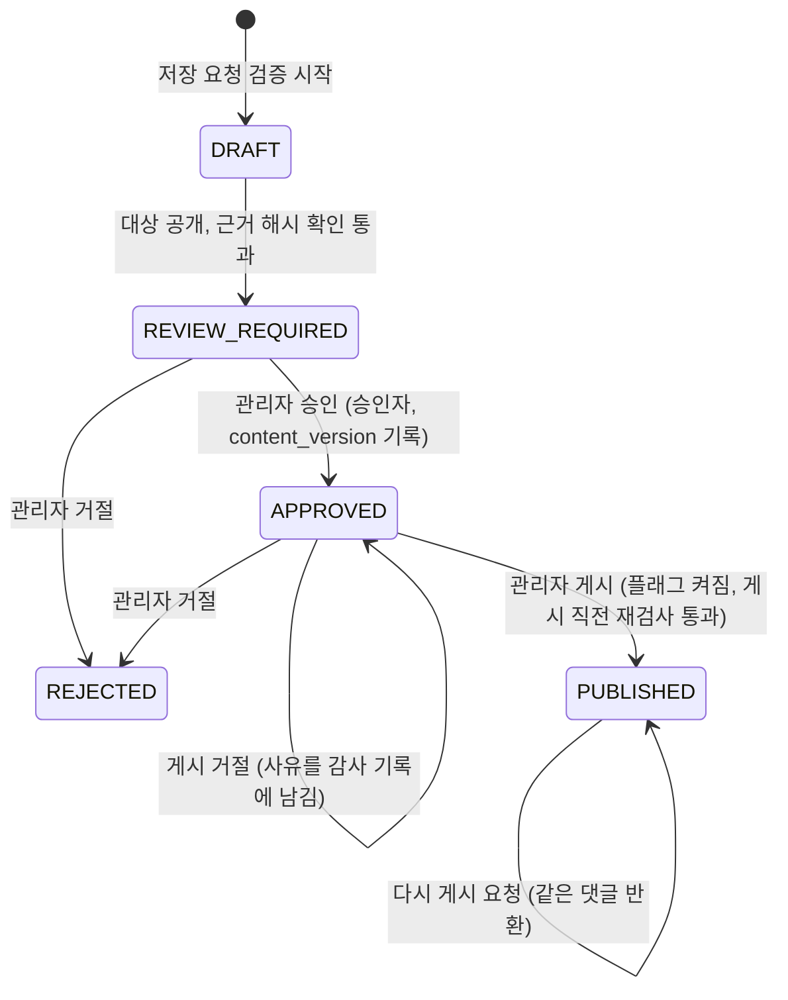

# 4단계 운영 검증: 제한 API 토큰과 답변 초안 승인 게시 흐름

- 상태: 로컬 구현과 검증 완료 (IKA-12). 운영 DB 마이그레이션, 배포, 게시 플래그 켜기는 하지 않았다.
- 기준일: 2026-11-04 (KST)
- 관련: `01_design.md` D1, D7 / `03_stage1_keyword_search.md` (근거 조회 계약) / `05_stage2_consistency.md`
- 마이그레이션: `database/production/029_migration_answer_draft.sql`

이 문서의 5절이 MCP 서버(`save_answer_draft`, `get_job_status`, `publish_approved_draft`)가 따라야 할 HTTP 계약이다.

## 1. 범위와 전제

- 0단계 판정(01_design §6)은 IKA-12를 보류했다. 이번 작업은 사용자 지시로 흐름과 안전 장치를 먼저 만든다. 운영 기본값은 읽기 전용이다(게시 플래그 꺼짐).
- 원칙: 모델은 초안 저장과 상태 조회만 한다. 승인과 게시는 사람이 관리자 세션에서 한다. 모델이 보낸 `confirmed=true` 같은 값은 상태에 영향이 없다(D7).
- D7과 다른 점: D7은 "게시는 초안 작성자의 권한으로 한다"였다. 이번 구현은 **승인한 관리자 이름으로** 댓글을 만든다. 사람이 승인 버튼을 눌러 책임을 지는 쪽이 작성자로 보여야 하고, 토큰 소유자와 승인자가 다를 수 있기 때문이다. 게시 요청자와 승인자가 다르면 게시 요청자는 `published_by_member_id`에 남는다.

## 2. 상태 기계



- DRAFT는 저장 트랜잭션 안의 시작 상태다. 검증을 통과한 행만 커밋되므로 저장된 초안은 항상 REVIEW_REQUIRED부터 시작한다.
- REJECTED와 PUBLISHED는 끝 상태다. 거절된 초안을 고치려면 새 멱등성 키로 새 초안을 저장한다.
- 게시 거절(대상 수정, 삭제, 근거 변경, 승인자 권한 상실, 플래그 꺼짐)은 상태를 바꾸지 않는다. 관리자가 거절하거나, 모델이 새 초안을 저장한다. 승인 이후 대상 게시글이 바뀐 초안은 다시 승인할 수 없다(APPROVED에서 승인 불가). 바뀐 질문을 다시 읽고 새 초안을 만드는 것이 맞기 때문이다.

## 3. 스키마 (029)

| 테이블 | 핵심 컬럼 | 제약 |
|---|---|---|
| `api_token` | member_id, name, token_prefix, token_hash(CHAR 64), scopes, expires_at, revoked_at, last_used_at | uk(token_hash), uk(public_id), fk member |
| `answer_draft` | target_post_id, target_post_public_id, body(1,000자), status, idempotency_key, request_hash, created_by_member_id, created_by_token_id, reviewed_by/at, approved_by/at, approved_post_content_version, reject_reason, published_comment_id, published_by/at, version | uk(created_by_member_id, idempotency_key), uk(published_comment_id), CHECK status, CHECK(PUBLISHED이면 comment 있음) |
| `answer_draft_evidence` | answer_draft_id, evidence_id, chunk_hash, sort_order | uk(answer_draft_id, evidence_id) |
| `answer_draft_audit` | answer_draft_id, action, actor_member_id, actor_token_id, reason_code, created_at | CHECK action |

- 근거를 JSON 컬럼이 아니라 자식 테이블로 둔 이유: 근거 ID 중복을 유일 제약으로 막고, 해시 길이와 NOT NULL을 DB가 보장한다. 나중에 "이 원문을 인용한 초안"을 인덱스로 찾을 수 있다. JSON은 이 셋을 DB가 지켜 주지 않고, 근거 수가 최대 20개라 행 수 부담도 작다.
- 대상 게시글은 연관(@ManyToOne)이 아니라 ID로 들고 있다. `Post`의 `@SQLRestriction("is_deleted = false")` 때문에 삭제된 게시글을 연관으로 읽으면 엔티티를 찾지 못한다. 공개 여부는 매번 `SearchSourceRepository`(근거 검색과 같은 조건: NORMAL, 삭제 안 됨, MARKET 아님)로 다시 읽는다.
- 적용 순서: 새 테이블만 만들므로 이전 앱 이미지에 영향이 없다. 운영은 `ddl-auto: validate`라 **앱 배포 전에** 029를 적용해야 한다. 두 번 실행해도 안전하다(`CREATE TABLE IF NOT EXISTS`).

## 4. 인증과 권한

### 4.1 API 토큰

- 형식: `snt_` + 32바이트 난수의 base64url(패딩 없음, 43자). 총 47자.
- 저장: 평문 SHA-256 hex와 표시용 앞 12자(`snt_` + 8자)만. 평문은 발급 응답에서 한 번만 내려가고 응답에 `Cache-Control: no-store`를 붙인다. 로그에 남기지 않는다.
- 해시: 토큰이 256비트 난수라 비밀번호처럼 느린 해시(bcrypt)가 필요 없다. 해시 컬럼 유일 인덱스로 바로 찾는다.
- 범위: `READ`(권한 `API_TOKEN_READ`), `DRAFT`(권한 `API_TOKEN_DRAFT`). 게시 범위는 없다. 라이브톡 위임 토큰의 `SCOPE_snowthing:read`와 이름을 일부러 다르게 했다. 위임 토큰이 관리자 근거 API에 들어오지 못하게 하기 위해서다.
- 만료: 1~30일, 기본 30일. 사용 중인 토큰은 회원당 최대 10개.
- 인증할 때마다 확인: 해시 일치, 폐기 안 됨, 만료 전, **소유자가 지금 ROLE_ADMIN이고 ACTIVE**. 하나라도 아니면 401 `API_TOKEN_001`(어느 이유인지 구분하지 않는다).
- `last_used_at`은 1분이 지났을 때만 갱신한다(요청마다 쓰기를 만들지 않으려고).
- 토큰 인증 회원에게는 ROLE_ADMIN을 주지 않고 범위 권한만 준다. 그래서 `/api/v1/admin/**` 중 아래 표에서 범위로 연 경로 말고는 모두 403이다. 승인, 거절, 게시, 목록, 토큰 발급은 어떤 토큰으로도 할 수 없다.
- 필터는 두 겹이다. `ApiTokenAuthenticationFilter`가 허용 경로(메서드 + 정규식) 밖이면 403으로 끊고, `SecurityConfig`가 범위 권한을 다시 검사한다.
- CSRF: `Authorization: Bearer snt_...` 요청 중 **아래 표의 토큰 허용 경로만** CSRF 검사를 건너뛴다(로그아웃처럼 토큰 필터보다 앞에서 도는 세션 처리에 가짜 Bearer 헤더로 들어오지 못하게 하려고). 브라우저가 Authorization 헤더를 자동으로 붙이지 않으므로 CSRF 대상이 아니다. 토큰이 틀리면 세션 인증으로 넘기지 않고 401로 끝내므로, 가짜 Bearer 헤더로 세션 쿠키 요청의 CSRF 검사를 우회할 수 없다.
- 세션: 토큰 요청은 보안 컨텍스트를 세션에 저장하지 않는다.

| 경로 | READ | DRAFT | 관리자 세션 |
|---|---|---|---|
| `GET /api/v1/admin/search/evidence` | 허용 | 403 | 허용 |
| `GET /api/v1/admin/search/evidence/{evidenceId}` | 허용 | 403 | 허용 |
| `POST /api/v1/answer-drafts` | 403 | 허용 | 허용 |
| `GET /api/v1/answer-drafts/{draftId}` | 403 | 허용(본인 초안만) | 허용 |
| `/api/v1/admin/answer-drafts/**` (목록, 상세, 승인, 거절, 게시) | 403 | 403 | 허용 |
| `/api/v1/admin/api-tokens/**` | 403 | 403 | 허용 |

### 4.2 첫 관리자 지정 (bootstrap)

운영에는 지금 ROLE_ADMIN 회원이 없고 권한을 줄 화면도 없다. 승인에는 사람 관리자가 필요하므로 설정으로 첫 관리자를 지정한다.

- 설정: `snowthing.admin.bootstrap-emails`, 환경 변수 `SNOWTHING_ADMIN_BOOTSTRAP_EMAILS`(쉼표 구분, 기본 빈 값).
- 동작: 앱이 준비되면(`ApplicationReadyEvent`) 목록의 이메일(앞뒤 공백 제거, 소문자)과 같은 **ACTIVE** 회원을 ROLE_ADMIN으로 올린다. 이미 관리자면 바꾸지 않고, 없는 이메일과 탈퇴, 정지 회원은 건너뛴다. 매번 기동해도 결과가 같다.
- 로그: 바뀐 회원 ID와 건수만 남긴다. 이메일은 남기지 않는다.
- **목록에서 이메일을 지워도 관리자 권한을 거두지 않는다.** 설정 실수 한 번으로 운영자가 관리자 화면에서 갑자기 밀려나지 않게 하려는 선택이다. 권한 회수는 별도 작업으로 DB에서 명시적으로 한다(`UPDATE member SET role = 'ROLE_USER' WHERE member_id = ?`). 회수 API는 이번에 만들지 않았다. 관리자가 한 명뿐인 지금은 스스로를 내리는 사고만 생기고 얻는 것이 적다.
- 관리자에서 내려가면 그 회원의 API 토큰은 다음 요청부터 401이 되고, 그 회원이 승인한 초안은 게시가 거절된다(4.1, 6절).

운영자가 켜는 방법(사용자 확인 후, 이번 작업에서는 하지 않았다):

1. 운영 서버의 백엔드 환경 파일(`prod.env`)에 `SNOWTHING_ADMIN_BOOTSTRAP_EMAILS=운영자 가입 이메일`을 추가한다. 이메일은 저장소에 커밋하지 않는다.
2. 029를 운영 DB에 적용한 뒤 백엔드 컨테이너를 다시 만들어(재배포) 환경 변수를 반영한다. 기동 로그에서 `Admin bootstrap: promoted 1 member(s)`를 확인한다.
3. 운영자는 **다시 로그인**한다. 세션의 권한은 로그인 시점 값이라 기존 세션에는 ROLE_ADMIN이 없다.
4. 헤더 프로필 메뉴의 "관리자"로 `/admin/answer-drafts`에 들어간다.
5. 지정이 끝나면 값을 지워도 된다(권한은 유지된다).

## 5. HTTP 계약

공통: 시각은 KST `LocalDateTime` 문자열(`2026-11-04T10:00:00.123456`). 오류 본문은 기존 형식 `{"code":"DRAFT_005","error":"ANSWER_DRAFT_INVALID_STATUS","message":"..."}`. ID는 모두 문자열이다.

### 5.1 초안 저장 (MCP `save_answer_draft`)

`POST /api/v1/answer-drafts`

- 인증: `Authorization: Bearer snt_...`(DRAFT 범위) 또는 관리자 세션(+CSRF).
- 요청:

```json
{
  "targetPostPublicId": "3f0c...-uuid",
  "body": "댓글로 게시될 본문 (1~1,000자)",
  "evidence": [
    { "evidenceId": "P:12:1", "chunkHash": "64자 hex" },
    { "evidenceId": "C:345:0", "chunkHash": "64자 hex" }
  ],
  "idempotencyKey": "mcp-20261104-abc123"
}
```

| 필드 | 규칙 |
|---|---|
| targetPostPublicId | UUID 형식. 근거 검색과 같은 공개 범위 안의 게시글 |
| body | 공백만은 불가, 1~1,000자 (댓글 제한과 같음) |
| evidence | 1~20개. `evidenceId`는 근거 ID 형식(03 문서 §5), 중복 불가. `chunkHash`는 64자 hex 필수(검색이나 근거 조회 응답의 `chunkHash`) |
| idempotencyKey | 8~100자, `[A-Za-z0-9._:-]`. 토큰 소유 회원 기준으로 유일. 대소문자를 구분한다(컬럼 `utf8mb4_bin`) |
| 그 밖의 필드 | 읽지 않고 버린다. `confirmed`, `approved`, `publish`, `status` 등을 보내도 결과는 같다 |

- 처리 순서: 형식 검사 → 같은 회원의 같은 멱등성 키 확인 → 대상 공개 여부 → 근거마다 `getEvidence(evidenceId, chunkHash)` (공개 범위 먼저, 그다음 해시) → 저장(REVIEW_REQUIRED) → 감사 기록 SAVE(토큰 ID 포함).
- 응답:
  - `201 Created`: 새로 저장.
  - `200 OK`: 같은 키, 같은 내용(대상, 본문, 근거 목록과 순서)의 기존 초안. 본문은 기존 초안 상태다(이미 승인, 게시되었으면 그 상태).
  - 본문(상태 응답, 5.2와 같음).

| 상태 | 코드 | 의미 |
|---|---|---|
| 400 | DRAFT_002 | 형식 오류 (근거 0개, 21개 이상, 중복, 해시 없음, 본문 길이, 키 형식 등) |
| 401 | API_TOKEN_001 | 토큰이 없거나 틀림, 폐기, 만료, 소유자 관리자 아님 |
| 403 | AUTH_002 | READ만 있는 토큰, 일반 회원 세션 |
| 404 | DRAFT_003 | 대상 게시글이 없거나 볼 수 없음 |
| 404 | EVIDENCE_001 | 근거 원문이 없거나 볼 수 없음 |
| 409 | EVIDENCE_002 | 근거 해시가 지금 원문과 다름 (다시 검색) |
| 409 | DRAFT_004 | 같은 키로 다른 내용 |
| 429 | DRAFT_012 | 작성자의 검토 대기(REVIEW_REQUIRED) 초안이 50개 이상. 같은 키 재시도는 상한과 상관없이 기존 초안을 돌려준다 |

- 같은 키 요청이 동시에 오면 한쪽은 유일 제약에 걸리고, 서버가 먼저 저장된 초안을 다시 읽어 200으로 돌려준다.

### 5.2 상태 조회 (MCP `get_job_status`)

`GET /api/v1/answer-drafts/{draftId}`

- 인증: DRAFT 범위 토큰(토큰 소유 회원이 만든 초안만) 또는 관리자 세션(모든 초안).
- 200 응답:

```json
{
  "draftId": "uuid",
  "status": "REVIEW_REQUIRED",
  "targetPostPublicId": "uuid",
  "targetPostUrl": "/posts/uuid",
  "evidenceCount": 2,
  "createdAt": "...",
  "updatedAt": "...",
  "reviewedAt": null,
  "approvedAt": null,
  "publishedAt": null,
  "publishedCommentId": null,
  "rejectReason": null,
  "reviewUrl": "/admin/answer-drafts/uuid"
}
```

- `targetPostUrl`: 대상이 지금 볼 수 없으면 null.
- `publishedCommentId`: 게시되었으면 댓글 ID 문자열.
- 404 `DRAFT_001`: 없거나, 토큰 요청인데 다른 회원의 초안(존재 여부를 알리지 않는다). 401, 403은 5.1과 같다.
- 본문과 근거 원문은 담지 않는다.

### 5.3 관리자 API (사람 전용, 세션 + CSRF)

| 메서드, 경로 | 설명 | 주요 오류 |
|---|---|---|
| `GET /api/v1/admin/answer-drafts?status=&page=0&size=20` | 목록. 생성 시각, ID 내림차순. size 1~50. 응답 `{items, page, size, hasNext, publishEnabled}` | 400 DRAFT_002 |
| `GET /api/v1/admin/answer-drafts/{draftId}` | 상세. 본문, 대상(현재 공개 여부, 제목, content_version), 근거마다 현재 상태(`MATCH`, `CHANGED`, `UNAVAILABLE`)와 현재 구간 텍스트, 감사 기록, `publishEnabled` | 404 DRAFT_001 |
| `POST .../{draftId}/approve` | REVIEW_REQUIRED만. 대상 공개 여부와 근거 해시를 다시 보고, 승인자와 그때의 `content_version`을 남긴다. 승인자는 지금 DB 기준 활성 관리자여야 한다 | 409 DRAFT_005, 409 DRAFT_007, 409 DRAFT_009, 403 AUTH_002 |
| `POST .../{draftId}/reject` | 본문 `{"reason":"선택, 255자 이하"}`. REVIEW_REQUIRED 또는 APPROVED만 | 409 DRAFT_005, 400 DRAFT_002 |
| `POST .../{draftId}/publish` | 6절 | 6절 |

### 5.4 게시 (관리자 세션 전용)

`POST /api/v1/admin/answer-drafts/{draftId}/publish` (본문 없음)

- 200 응답:

```json
{
  "draftId": "uuid",
  "status": "PUBLISHED",
  "publishedCommentId": "678",
  "publishedAt": "...",
  "targetPostPublicId": "uuid",
  "alreadyPublished": false
}
```

- 이미 게시된 초안이면 같은 댓글로 200, `alreadyPublished: true`.

| 상태 | 코드 | 의미 | 감사 기록 |
|---|---|---|---|
| 403 | DRAFT_006 | 게시 플래그 꺼짐 | PUBLISH_REJECTED |
| 404 | DRAFT_001 | 초안 없음 | 없음 |
| 409 | DRAFT_005 | APPROVED가 아님 | PUBLISH_REJECTED |
| 409 | DRAFT_007 | 대상 게시글 삭제, 숨김 | PUBLISH_REJECTED |
| 409 | DRAFT_008 | 승인 이후 대상 게시글 수정(content_version 변경) | PUBLISH_REJECTED |
| 409 | DRAFT_009 | 근거 원문 변경, 삭제, 비공개 | PUBLISH_REJECTED |
| 409 | DRAFT_010 | 승인자가 더 이상 활성 관리자가 아님 | PUBLISH_REJECTED |
| 403 | AUTH_002 | 게시 요청자가 지금 활성 관리자가 아님, 토큰 요청 | 없음 |

### 5.5 MCP 도구 동작 (결정)

- `save_answer_draft` → 5.1. 모델이 만든 멱등성 키를 재시도에 그대로 쓴다. 201과 200 모두 성공으로 보고 `draftId`, `status`, `reviewUrl`을 돌려준다. 응답 문구에 "사람이 검토 화면에서 승인해야 게시된다"를 넣는다.
- `get_job_status` → 5.2.
- `publish_approved_draft` → **서버 호출 없이 안내만 돌려준다.** 게시는 설계상 토큰으로 할 수 없다(게시 범위 없음, `/api/v1/admin/answer-drafts/**`는 ROLE_ADMIN 세션 전용). 도구는 먼저 `get_job_status`로 상태를 읽고:
  - `APPROVED`: "관리자 화면 `{reviewUrl}`에서 게시 버튼을 눌러 주세요"를 돌려준다.
  - `REVIEW_REQUIRED`: "아직 사람 승인 전입니다"를 돌려준다.
  - `PUBLISHED`: `publishedCommentId`를 돌려준다.
  - `REJECTED`: `rejectReason`과 함께 새 초안이 필요하다고 돌려준다.
- 이유: 모델이 게시까지 이어서 호출할 수 있는 경로가 하나라도 있으면 "사람 승인"이 형식만 남는다. 로컬 STDIO에서 브라우저 `JSESSIONID`를 복사해 게시를 부르는 방식도 같은 이유로 쓰지 않는다. MCP 서버는 게시 엔드포인트를 호출하지 않아야 한다.

## 6. 게시 직전 재검사와 멱등성

한 트랜잭션에서 아래 순서로 한다(`AnswerDraftCommandService.publish`).

1. 초안 행을 `SELECT ... FOR UPDATE`로 잠근다. 상태가 PUBLISHED면 그 댓글을 돌려주고 끝낸다. 동시에 들어온 두 번째 요청은 여기서 기다렸다가 첫 요청의 커밋 뒤 PUBLISHED를 본다.
2. APPROVED가 아니면 거절.
3. 게시 요청자가 지금 활성 관리자인지 본다.
4. 대상 게시글 행을 `findByIdForUpdate`로 잠근다. 게시글 수정 경로가 같은 잠금을 쓰므로 검사와 댓글 작성 사이에 내용이 바뀌지 않는다.
5. 공개 범위(근거 검색과 같은 조건)와 `content_version == approved_post_content_version`을 본다.
6. 승인자가 지금 ROLE_ADMIN이고 ACTIVE인지 본다.
7. 근거마다 `getEvidence(evidenceId, 저장 시점 해시)`를 다시 부른다.
8. 기존 `CommentService.createComment`로 **승인자 이름의** 댓글을 만든다. 마켓 검사, 검색 outbox 기록, 댓글 수 증가가 그대로 일어난다.
9. 초안을 PUBLISHED로 바꾸고 `published_comment_id`를 남긴다. 감사 기록 PUBLISH.

- 내구성 있는 멱등성: 메모리 상태가 아니라 DB 행 잠금과 상태로 판단하므로 서버를 여러 대 띄우거나 재시작해도 같은 초안이 두 댓글을 만들지 않는다. 댓글 생성과 상태 변경이 한 트랜잭션이라 "댓글은 생겼는데 초안은 APPROVED" 상태가 남지 않는다. `published_comment_id` 유일 제약이 마지막 방어선이다.
- 거절 기록: 2~7에서 거절되면 게시 트랜잭션을 되돌린 뒤 별도 트랜잭션으로 PUBLISH_REJECTED와 사유 코드를 남긴다. 되돌림 뒤에 쓰므로 거절되어도 기록이 남는다.
- 구현 주의: 댓글 수 증가 쿼리(`@Modifying(clearAutomatically = true)`)가 영속성 컨텍스트를 비우므로 8 뒤에 초안을 다시 읽어 상태를 바꾼다. 행 잠금은 트랜잭션 끝까지 유지된다.
- 남는 틈: 근거 원문 행은 잠그지 않는다. 7과 커밋 사이에 근거 원문이 바뀌는 짧은 구간은 남는다. 근거는 다른 글이라 잠그면 무관한 수정까지 막게 되어 받아들였다.

## 7. 관리자 화면

- `/admin/answer-drafts`: 상태 필터(기본 검토 대기), 목록, 게시 플래그가 꺼져 있으면 안내.
- `/admin/answer-drafts/{draftId}`: 대상 게시글 링크, 승인 시점과 현재 content_version, 본문, 근거마다 현재 상태와 구간 텍스트, 승인, 거절(사유), 게시(플래그가 꺼져 있으면 비활성), 감사 기록.
- `/admin/api-tokens`: 만들기(평문은 한 번만 표시), 목록(접두사, 범위, 만료, 마지막 사용), 폐기.
- `/admin/search`: outbox 상태(`GET /api/v1/admin/search/outbox/summary`)와 "검색 인덱스 대조 실행"(`POST /api/v1/admin/search/reconcile`) 결과.
- 진입: 헤더 프로필 메뉴의 "관리자" 링크는 `role == ROLE_ADMIN`일 때만 보인다. 관리자 레이아웃도 `members/me`로 역할을 확인하고 아니면 내용을 그리지 않는다. 화면 숨김은 편의이고 실제 차단은 서버가 한다. 페이지는 `noindex`.

## 8. 설정

| 키 | 환경 변수 | 기본값 |
|---|---|---|
| `snowthing.answer-draft.publish-enabled` | `SNOWTHING_ANSWER_DRAFT_PUBLISH_ENABLED` | `false` (운영 포함) |
| `snowthing.admin.bootstrap-emails` | `SNOWTHING_ADMIN_BOOTSTRAP_EMAILS` | 빈 값 |

플래그를 켜도 자동 게시는 없다. 사람이 승인하고 게시 버튼을 눌러야 한다. 두 값 모두 앱을 다시 띄워야 반영된다.

## 9. 검증

- `AnswerDraftFlowIntegrationTest` 18개, `AdminBootstrapIntegrationTest` 3개 (전용 테스트 DB `snowthing_ika12_test`).
  - 저장: `confirmed`, `approved`, `publish`, `status` 필드를 보내도 REVIEW_REQUIRED, 댓글 0개. 멱등성 200 재사용과 다른 내용 409. 숨김 대상 404, 해시 불일치 409, 형식 400. 다른 회원 토큰의 상태 조회 404.
  - 토큰 범위: READ 토큰의 초안 저장 403, DRAFT 토큰의 승인, 거절, 게시, 목록, 상세, 토큰 발급, 근거 조회 403(상태 그대로, 댓글 0개). 폐기, 만료, 소유자 강등, 없는 토큰, 형식 오류 401. 평문이 DB 행 어디에도 없고 해시와 접두사만 있음. 일반 회원의 토큰 발급 403.
  - 게시: 승인 후 게시하면 승인자 이름의 댓글 1개, 댓글 수 1, 검색 outbox 기록, 다시 게시하면 같은 댓글(`alreadyPublished`). 두 스레드 동시 게시에도 댓글 1개. 승인 후 대상 수정 DRAFT_008, 삭제 DRAFT_007, 근거 변경 DRAFT_009(상세에 CHANGED 표시), 승인자 강등 DRAFT_010, 플래그 꺼짐 DRAFT_006, 모두 상태 APPROVED 유지와 PUBLISH_REJECTED 기록. 승인 전, 거절 후 게시 DRAFT_005. 승인 시 승인자와 content_version 기록.
  - bootstrap: 빈 설정 무변경, 없는 이메일과 탈퇴 회원 무시, 대소문자와 공백 정규화, 두 번 실행 무변경, 목록에서 빠져도 강등 없음.
- 전체 결과와 마이그레이션 검증 결과는 PR 본문과 `docs/project/work.md`에 적는다.

## 10. 하지 않은 것과 남은 위험

- 운영 DB 029 적용, 배포, bootstrap 이메일 설정, 게시 플래그 켜기는 하지 않았다(사용자 확인 필요).
- MCP 서버 도구 구현은 이 저장소 밖(mcp-server)의 일이다. 5절 계약을 따른다.
- 관리자 권한 회수 API, 토큰 이름 변경, 초안 수정 API는 만들지 않았다.
- 6절의 근거 원문 경합 틈.
- 0단계 판정대로 QNA 규모가 작아 실제 효과 측정은 범위 밖이다.
