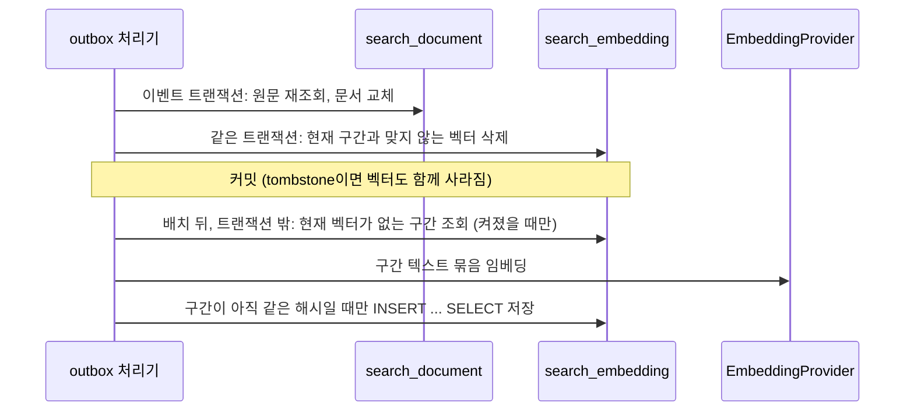

# 3단계 품질 개선 실험: 의미 검색 RRF 결합과 비교 평가 구조

- 상태: 구현과 로컬 검증 완료, **품질, 비용, 지연 결과 미측정** (§9). 운영 미적용, 기능 기본 꺼짐
- 기준일: 2026-11-04 (KST)
- Linear: IKA-11 (부모 IKA-5)
- 상위 설계: `01_design.md` §4 3단계. 기준선: `03_stage1_keyword_search.md`, 평가 방법: `04_evaluation.md`, 정합성: `05_stage2_consistency.md`
- 파일 이름의 `stage5`는 작업 지시에 따른 이름이다. 내용은 01 설계의 3단계(품질 개선)다.

## 1. 범위

| 포함 | 제외 |
|---|---|
| `search_embedding` 테이블 (030) | 실제 임베딩 API 호출, 비용 발생 작업 (사용자 승인 전) |
| `EmbeddingProvider` 인터페이스, 해시 제공자(로컬 확인용), OpenAI 호환 HTTP 제공자(호출 안 함) | 재정렬기 구현 (인터페이스와 비교 경로만) |
| outbox 처리기에 벡터 삭제와 갱신 연결 | 사람 정답 라벨링 (사용자 작업) |
| 관리자 근거 검색 `mode=keyword|hybrid|hybrid_rerank`, RRF 결합 | 운영 배포, 운영 030 적용 |
| 평가 실행기의 방식별 Recall n/N, P50/P95, 비용 집계 | |
| 정답 라벨링 양식 `07_gold_labels_template.jsonl` | |
| 기동 시 빈 색인 채우기 (§8, 운영 관리자 계정 부재 대응) | |

완료 기준(01 설계 §4): 같은 평가 자료로 기준선 대비 결과, 비용, 지연을 기록하고 개선이 없으면 도입하지 않는다. 이번 작업은 그 비교를 **돌릴 수 있는 구조**까지다. 결과는 라벨링과 비용 승인 뒤에 채운다.

## 2. 저장 결정: MySQL BLOB + 앱 코사인

MySQL 8.0에는 벡터 타입과 벡터 인덱스가 없다(01 설계 §2).

### search_embedding (030_migration_search_embedding.sql)

| 컬럼 | 설명 |
|---|---|
| embedding_id | PK |
| evidence_id | search_document의 근거 ID. document_id가 아니라 이것을 쓴다. 처리기가 문서를 지우고 다시 넣으면 document_id는 바뀌지만 근거 ID는 같다 |
| model_id | 제공자와 모델, 차원을 담은 식별자. 예: `http:<model>:d1536`, `hashing-bigram-v1-d256` |
| post_id, source_type, source_id | 원문 삭제 때 벡터를 찾아 지우는 데 쓴다 |
| content_hash | 벡터를 만든 구간의 `chunk_hash` |
| dimension | 차원 |
| vector | float32 little-endian 배열 BLOB. CHECK로 `OCTET_LENGTH(vector) = dimension x 4` |
| created_at | 만든 시각 |

- 유일 키 `(evidence_id, model_id)`: 모델을 바꾸면 새 행이 생겨 두 모델을 나란히 둘 수 있다. 검색은 지금 제공자의 model_id만 본다.
- 원문 내용(제목, 본문)은 넣지 않는다. 벡터는 원문에서 다시 만들 수 있는 파생 데이터다.
- FK는 두지 않는다. search_document와 같은 이유(재구축 가능한 복제본, 조회할 때 원문과 조인).
- **현재 벡터** = `model_id`가 지금 제공자이고 `content_hash = search_document.chunk_hash`인 벡터. 원문이 바뀌어 해시가 달라진 벡터는 검색에 쓰이지 않는다.

### 다른 선택지

| 선택지 | 판단 |
|---|---|
| 별도 벡터 DB(pgvector, OpenSearch k-NN 등) | 동기화 대상과 운영 비용이 하나 는다. 공개 글 약 100건 규모에는 과하다 |
| MySQL 9 VECTOR 타입, HeatWave | 운영 RDS가 8.0이다. 엔진 업그레이드는 이 실험의 범위가 아니다 |
| JSON 배열 컬럼 | 크기가 3~4배이고 파싱 비용이 든다. 이점이 없다 |
| 앱 메모리 캐시 | 인스턴스마다 캐시와 무효화가 필요하다. 지금 규모에서는 매번 읽어도 된다 |

### 전수 비교가 버티는 한계

- 하이브리드 검색 한 번이 공개 범위와 조건을 통과한 현재 벡터를 **모두** 읽어 앱에서 코사인을 계산한다. 읽는 양은 `구간 수 x 차원 x 4바이트`다. 1536차원이면 구간 하나에 약 6KB다.
- 계산 예(측정 아님): 1,000구간이면 질의당 약 6MB, 5,000구간이면 약 30MB를 DB에서 읽는다. 대략 수천 구간을 넘으면 질의당 전송량과 GC 부담이 커져 맞지 않는다고 본다. 그 전에 (1) 인스턴스 메모리 캐시 + 해시 기반 무효화, (2) 벡터 DB 도입, (3) MySQL 엔진 업그레이드 중 하나를 다시 정한다.
- 운영 구간 수는 재지 않았다. 재인덱싱 뒤 `SELECT COUNT(*) FROM search_document`로 확인한다.
- 안전장치(리뷰 반영): `max-vector-scan`(기본 5,000). 벡터 조회에 `LIMIT 상한 + 1`을 걸고, 공개 범위와 조건을 통과한 벡터가 상한을 넘으면 하이브리드 검색을 409 SEARCH_002로 거절한다. 일부만 비교하면 결과가 조용히 틀어지기 때문이다. 이 오류가 나면 위 대안 중 하나를 정할 때다.

## 3. 벡터 갱신과 정합성 (outbox에 연결)



- 이벤트 트랜잭션 안(`SearchEmbeddingIndexer.removeOutdatedOfPost/Comment`): 게시글 이벤트면 그 글과 댓글의 벡터 중, 같은 근거 ID와 같은 해시의 문서가 없는 것을 지운다. 댓글 이벤트면 그 댓글 벡터만. 삭제, 숨김, MARKET 이동, 내용 변경이 모두 여기서 정리된다. **의미 검색이 꺼져 있어도 지운다.** 지운 원문에서 나온 파생 데이터를 남기지 않기 위해서다. DB 문장 하나이고 제공자 호출은 없다.
- 오래된 이벤트: 처리기가 버전 비교로 문서를 건드리지 않고 끝내므로(05 문서 §4) 벡터 삭제도 부르지 않는다. 벡터도 그대로다.
- 유휴 간격(리뷰 반영): 처리한 이벤트가 없는 폴링에서는 "벡터 없는 구간" 조인 조회를 `refresh-idle-interval-ms`(기본 30초)에 한 번만 한다. 이벤트를 처리한 폴링은 바로 조회하고, 배치 상한까지 채우고도 남았으면 다음 폴링이 간격 없이 잇는다. 제공자 실패 뒤 쉬는 시간은 이벤트가 있어도 지킨다.
- 배치 뒤(`refreshMissing`): 켜져 있을 때만. `search_document LEFT JOIN search_embedding`(같은 model, 같은 해시)으로 현재 벡터가 없는 구간을 document_id 순으로 32개씩, 폴링 한 번에 최대 4배치 가져와 제공자에 보낸다. 처음 켰을 때 기존 구간 전체 채우기도 같은 경로다.
- 저장 조건: `INSERT INTO search_embedding ... SELECT ... FROM search_document WHERE evidence_id = ? AND chunk_hash = ?`. 제공자를 부르는 사이 처리기가 구간을 바꿨으면 SELECT가 비어 아무것도 쓰지 않는다. 옛 해시로 만든 벡터가 새 구간에 붙지 않는다.
- 외부 호출을 이벤트 트랜잭션 밖에 둔 이유: 처리 트랜잭션은 상태 행 잠금을 잡는다. 그 안에서 수 초짜리 HTTP 호출을 하면 같은 글의 다른 이벤트가 그동안 기다린다. 제공자 장애가 키워드 색인까지 막지 않게 하려는 목적도 있다.
- 실패: 제공자 예외는 키워드 색인과 outbox 상태에 영향이 없다. 갱신만 5초부터 두 배씩 최대 10분 쉰다. 로그에는 예외 종류만 남긴다.
- 빈 구간: 제공자에 보내지 않고 0 벡터로 저장한다. 계속 "없음"으로 잡혀 반복 호출되는 것을 막는다.

다른 선택지: 벡터 갱신을 별도 outbox 테이블로 두기. 재시도와 상태를 따로 관리할 수 있지만, "현재 벡터가 없는 구간"을 조인으로 바로 찾을 수 있어 큐가 하나 더 필요하지 않다. 규모가 커져 조인이 무거워지면 다시 본다.

## 4. 하이브리드 검색과 RRF

`GET /api/v1/admin/search/evidence?mode=hybrid` (`HybridEvidenceSearch`)

1. 키워드 상위 K: 1단계 FULLTEXT 검색 그대로. 같은 `createdBefore`, `excludePostPublicId`, `categoryCode`.
2. 질문 임베딩 1회.
3. 벡터 상위 K: `search_embedding`을 `search_document`와 조인하고, 키워드 검색과 **같은** 원문 조인(`post`, `post_category`, `comment`)과 `SearchVisibilitySql` 조건, 같은 평가용 조건을 건다. 코사인 내림차순, 같으면 document_id 오름차순.
4. RRF: `score(d) = Σ 1 / (k + rank_i(d))`, rank는 1부터, 기본 k = 60. **원점수는 더하지 않는다.** FULLTEXT 관련도와 코사인은 단위와 분포가 달라 더하면 한쪽이 결과를 지배한다.
5. 같은 점수면 가장 좋은 순위가 작은 쪽, 그다음 그 순위를 낸 목록(키워드 먼저), 그다음 근거 ID 사전순. 한 목록 안에서 같은 ID가 두 번 나오면 처음 순위만 센다.
6. 상위 `size`개를 1단계와 같은 항목 형식으로 돌려준다. 점수는 넣지 않는다(D4).

- 숨김, 삭제, MARKET 글과 삭제 댓글은 두 경로 모두 조회 시 원문 조인에서 빠진다. 색인에 문서와 벡터가 남아 있어도 나오지 않는다(통합 테스트 `hybridRespectsVisibility`).
- 트랜잭션: 검색 메서드는 트랜잭션 없이 돈다(`NOT_SUPPORTED`). 외부 호출 동안 DB 연결과 스냅샷을 잡지 않는다. 각 쿼리는 SELECT 하나다.
- 응답에 `mode`와 `usage`를 더했다(추가만, 기존 필드는 그대로).

```json
{
  "query": "바인딩 각도",
  "size": 10,
  "mode": "hybrid",
  "usage": {
    "embeddingModel": "http:<model>:d1536",
    "embeddingCalls": 1,
    "embeddingInputTokens": 6,
    "rerankCalls": 0,
    "keywordCandidates": 12,
    "vectorCandidates": 240
  },
  "items": []
}
```

| 오류 | HTTP | 경우 |
|---|---|---|
| SEARCH_001 | 400 | `mode` 값이 keyword, hybrid, hybrid_rerank가 아님 |
| SEARCH_002 | 409 | 의미 검색이 꺼져 있는데 hybrid 요청, 재정렬기가 없는데 hybrid_rerank 요청 |
| SEARCH_003 | 503 | 질문 임베딩 또는 재정렬 호출 실패 |

`mode`가 없거나 `keyword`면 1단계와 결과가 같다. 키워드 응답의 `usage`는 `embeddingCalls = 0`이다.

## 5. 재정렬 비교

- `EvidenceReranker` 인터페이스만 두었다. `mode=hybrid_rerank`면 RRF 상위 K를 질문과 함께 넘기고, 돌려준 순서를 쓴다. 후보에 없는 ID는 버리고 빠진 후보는 원래 순서로 뒤에 붙인다.
- 구현은 넣지 않았다. cross-encoder나 LLM 재정렬은 질의마다 호출 비용과 수백 ms 이상의 지연이 생긴다. 먼저 keyword 대 hybrid를 재 보고, hybrid가 기준선보다 나을 때만 재정렬 실험을 따로 승인받아 붙인다. 재정렬기 빈이 없으면 hybrid_rerank는 409다.

## 6. 설정

| 속성 | 기본값 | 환경 변수 |
|---|---|---|
| `snowthing.search.semantic.enabled` | false | `SNOWTHING_SEARCH_SEMANTIC_ENABLED` |
| `snowthing.search.semantic.provider` | none (none, hashing, http) | `SNOWTHING_SEARCH_SEMANTIC_PROVIDER` |
| `snowthing.search.semantic.rrf-k` | 60 | `SNOWTHING_SEARCH_SEMANTIC_RRF_K` |
| `snowthing.search.semantic.candidate-k` | 50 (최대 200) | `SNOWTHING_SEARCH_SEMANTIC_CANDIDATE_K` |
| `snowthing.search.semantic.refresh-batch-size` / `refresh-max-batches` | 32 / 4 | |
| `snowthing.search.semantic.refresh-idle-interval-ms` | 30000 | |
| `snowthing.search.semantic.max-vector-scan` | 5000 | `SNOWTHING_SEARCH_SEMANTIC_MAX_VECTOR_SCAN` |
| `snowthing.search.semantic.http.base-url` | 빈 값 | `SNOWTHING_SEARCH_EMBEDDING_BASE_URL` |
| `snowthing.search.semantic.http.model` | 빈 값 | `SNOWTHING_SEARCH_EMBEDDING_MODEL` |
| `snowthing.search.semantic.http.dimension` | 0 | `SNOWTHING_SEARCH_EMBEDDING_DIMENSION` |
| `snowthing.search.semantic.http.api-key` | 빈 값 | `SNOWTHING_SEARCH_EMBEDDING_API_KEY` |
| `snowthing.search.bootstrap-on-empty` | true | `SNOWTHING_SEARCH_BOOTSTRAP_ON_EMPTY` (§8) |

- 꺼져 있으면(기본) `SemanticSearchSupport`가 제공자를 잡지 않는다. 작성, 수정, 삭제, outbox 처리, 검색 어디에서도 제공자를 부르지 않는다(통합 테스트 `SemanticSearchDisabledIntegrationTest`가 호출 수 0을 확인). 운영 동작은 1단계, 2단계와 같고 비용이 없다.
- 켰는데 제공자가 없으면(provider=none) 기동을 멈춘다. 조용히 키워드로 바뀌어 비교가 무의미해지는 것을 막는다.
- `hashing`: 공백을 뺀 글자 2-gram 해시(256차원). 외부 호출과 비용이 없다. **의미 모델이 아니다.** 글자 겹침만 보므로 키워드와 비슷한 신호다. 파이프라인 확인용이고 이 값으로 잰 Recall은 품질 결과로 쓰지 않는다.
- `http`: OpenAI 호환 `POST {base-url}/embeddings`(`model`, `input` 배열, `encoding_format=float`), 응답 `data[].embedding`, `usage.prompt_tokens`. https만 허용(localhost 제외), 리디렉션을 따라가지 않는다. 키는 환경 변수로만 받고 로그, 예외 메시지, `toString`에 나오지 않는다. 오류 응답 본문도 예외 메시지에 넣지 않는다. 호출마다 비용이 생길 수 있으므로 **켜기 전에 사용자 승인이 필요하다.** 이번 작업에서는 부르지 않았다(계약 테스트는 MockRestServiceServer로만).

## 7. 비용 모델

단가는 제공자와 모델에 따라 다르고 이번에 정하지 않았다. 아래는 식이며 숫자를 채우지 않았다.

| 항목 | 호출 수 | 입력 토큰 |
|---|---|---|
| 처음 켤 때 채우기 | `ceil(구간 수 / 32)` | 전체 구간 텍스트의 토큰 합 |
| 게시글 수정 | 바뀐 구간 수만큼 (해시가 같은 구간은 다시 보내지 않음) | 바뀐 구간 토큰 |
| 댓글 작성, 수정 | 1구간 | 댓글 토큰 |
| 하이브리드 검색 1회 | 1 | 질문 토큰 (검색어 최대 100자) |
| 평가 1회 (17문항 x hybrid) | 17 | 17문항 질문 토큰 합 |
| 재정렬 (붙일 경우) | 질의당 1 | 후보 K개 텍스트 합. 임베딩보다 훨씬 크다 |

- 추정 비용 = 입력 토큰 / 1,000,000 x 100만 토큰당 단가.
- 평가 실행기는 응답 `usage`의 호출 수와 토큰을 방식별로 합산하고, `--price-per-million-tokens`를 주면 질문 임베딩 추정 비용을 계산한다. 색인 채우기 비용은 실행기가 보지 못하므로 따로 계산한다: 켜기 전에 `SELECT COUNT(*), SUM(CHAR_LENGTH(COALESCE(title, body))) FROM search_document`로 구간 수와 글자 수를 보고, 사용하는 모델의 토큰화 기준으로 바꿔 승인받는다.
- 비용이 생기는 작업(http 제공자로 켜기, 채우기, 평가 실행)은 모두 사용자 승인 뒤에 한다.

## 8. 기동 시 빈 색인 채우기 (bootstrap)

운영에는 관리자 계정이 없다. IKA-10 배포 뒤 `POST /api/v1/admin/search/reconcile`이나 `/reindex`를 부를 사람이 없고, 기존 게시글은 search_document에 들어 있지 않다. 매일 04:30 대조가 결국 메우지만 배포 직후부터 최대 하루 동안 색인이 빈다.

`SearchIndexBootstrap`이 ApplicationReadyEvent에서 전용 데몬 스레드(`search-index-bootstrap`) 하나를 띄워 아래를 모두 만족하면 2단계의 체크포인트 재인덱싱(`SearchConsistencyService.reindex()`)을 DONE이 될 때까지(최대 50번 호출) 부른다. 재인덱싱은 outbox에 게시글 이벤트만 넣고, 실제 색인은 평소 처리기가 한다.

1. `snowthing.search.indexer.enabled=true` (처리기가 없으면 넣어도 반영되지 않는다)
2. `snowthing.search.bootstrap-on-empty=true` (기본)
3. `search_index_state`가 0행 (한 번이라도 처리한 적이 있으면 실행하지 않는다)
4. 공개 게시글이 1건 이상
5. `search_reindex_checkpoint`의 FULL 행이 없거나 RUNNING

- 여러 인스턴스: FULL 행이 없으면 `INSERT IGNORE`로 RUNNING 행을 먼저 만든 인스턴스만 시작한다. 늦은 인스턴스는 RUNNING이면 이어서 부르고 DONE이면 건너뛴다. 재인덱싱 배치는 체크포인트 행 `FOR UPDATE` 잠금 안에서 `last_source_id`를 옮기므로(05 문서 §7) 두 인스턴스가 함께 이어서 해도 같은 배치를 두 번 넣지 않는다. 겹쳐 들어간 이벤트가 있더라도 처리기가 멱등이라 결과는 같다.
- 처리기가 아직 이벤트를 하나도 반영하지 않은 사이 다른 인스턴스가 뜨면, 상태는 비어 있지만 체크포인트가 DONE이라 다시 넣지 않는다.
- 기동 스레드를 잡지 않는다(리뷰 반영). 한 번만 쓰는 작업이라 공용 비동기 실행기(`AsyncConfig`)의 스레드를 빌리지 않고 전용 스레드를 쓴다.
- 실패해도 기동은 막지 않고 예외 종류만 로그에 남긴다. 다음 기동이나 매일 대조가 메운다.
- 끄려면 `SNOWTHING_SEARCH_BOOTSTRAP_ON_EMPTY=false`.
- 테스트: 빈 색인이면 재인덱싱이 DONE까지 가고 처리 뒤 문서가 생김, 그 뒤 다시 부르면 실행 안 함. 상태 행이 있으면 실행 안 함. 플래그나 처리기가 꺼져 있으면 실행 안 함. 체크포인트 DONE이면 건너뛰고 RUNNING이면 이어서 함(`SearchIndexBootstrapIntegrationTest`).

## 9. 비교 실행 방법

### 9.1 정답 라벨 채우기 (사용자)

1. `docs/conception/017_ai_answer_assist/07_gold_labels_template.jsonl`을 **저장소 밖**으로 복사한다. 예: `D:/private/snowthing-eval/qna-eval.jsonl`. 실행기는 저장소 안 경로를 거부한다(D8, 공개 저장소).
2. 17줄이 QNA 질문 17건에 하나씩이다. `q01`~`q05`는 `tuning`, `q06`~`q17`은 `eval`로 미리 나눠 두었다. 질문 작성 순서대로 번호를 매기면 04 문서 §3의 예와 같다.
3. 줄마다 채운다.

| 필드 | 채울 값 |
|---|---|
| question | 질문 글 제목 + 본문 핵심 문장. 검색어로 쓴다(100자 넘으면 앞 100자) |
| query | 선택. 따로 줄 검색어 |
| askedAt | 질문 글 작성 시각, KST `YYYY-MM-DDTHH:mm:ss` |
| questionPostPublicId | 질문 글 publicId. 자리표시자 `00000000-...`를 그대로 두고 reviewedBy를 채우면 실행기가 거부한다 |
| expectedEvidenceIds | 답이 되는 근거 ID 목록. 고르는 기준은 04 문서 §3 (질문 시각 이전, 자기 글타래 제외, 검색에 안 나온 근거도 직접 찾기). 답이 없으면 `[]` |
| reviewedBy | 라벨링한 사람. 비어 있으면 집계에서 빠진다 |

4. 하이브리드 결과를 보고 정답을 고르면 하이브리드가 유리해진다. 라벨링은 키워드와 하이브리드 결과를 보기 전에, 또는 둘 다 보지 않고 원문을 직접 읽어 끝낸다.

### 9.2 실행 (비용 승인 뒤)

```powershell
# 서버: 의미 검색을 켠 로컬 또는 테스트 서버. http 제공자는 비용 승인 뒤에만
$env:SNOWTHING_SEARCH_SEMANTIC_ENABLED = "true"
$env:SNOWTHING_SEARCH_SEMANTIC_PROVIDER = "http"
$env:SNOWTHING_SEARCH_EMBEDDING_BASE_URL = "https://<제공자>/v1"
$env:SNOWTHING_SEARCH_EMBEDDING_MODEL = "<모델>"
$env:SNOWTHING_SEARCH_EMBEDDING_DIMENSION = "<차원>"
$env:SNOWTHING_SEARCH_EMBEDDING_API_KEY = "<키>"
# 서버를 띄우고 outbox 처리기가 벡터 채우기를 끝낼 때까지 기다린다.
# 확인: SELECT COUNT(*) FROM search_document d LEFT JOIN search_embedding e ON e.evidence_id = d.evidence_id AND e.content_hash = d.chunk_hash WHERE e.embedding_id IS NULL;  -> 0

# 실행기
$env:SNOWTHING_EVAL_COOKIE = "JSESSIONID=<관리자 세션 값>"
python -I scripts/evaluate-evidence-search.py `
  --eval-set D:/private/snowthing-eval/qna-eval.jsonl `
  --base-url https://<대상 서버> --split eval --modes keyword,hybrid `
  --price-per-million-tokens <단가> `
  --output D:/private/snowthing-eval/result-hybrid-eval.json
Remove-Item Env:SNOWTHING_EVAL_COOKIE
```

- 항목마다 keyword, hybrid를 번갈아 같은 조건(`size=10`, `createdBefore=askedAt`, `excludePostPublicId`)으로 부른다. 시간에 따른 서버 상태 변화가 한 방식에만 몰리지 않게 한다.
- 응답 `mode`가 요청과 다르면 그 항목을 `mode_mismatch` 오류로 센다. IKA-11 이전 서버(응답에 mode 없음)에 hybrid를 요청하면 키워드끼리 비교하는 셈이 되기 때문이다.
- 결과 파일의 `modes.<방식>`에 hit@k, recall@k(n/N), 근거 없음 항목, `latencyMs` P50/P95, `cost`(임베딩 호출 수, 입력 토큰, 추정 비용), 상태별 오류가 들어간다. 질문 원문과 근거 ID는 쓰지 않는다. 기존 안전장치(리디렉션을 따라가지 않음, JSON이 아닌 200 응답은 오류로 셈, 쿠키는 환경 변수로만)는 그대로다.
- 지연은 실행기에서 잰 HTTP 왕복이다. hybrid는 질문 임베딩 왕복이 포함된다. 서버와 실행기 위치를 결과와 함께 적는다.
- `tuning`으로 k, K를 바꿔 보고 `eval`은 마지막 비교에 한 번만 쓴다(04 문서 §3).

## 10. 결과

**미측정.** 아래 칸은 실제 측정으로만 채운다.

| 방식 | hit@1 | hit@3 | hit@5 | hit@10 | recall@10 | P50 | P95 | 질의 임베딩 호출 / 토큰 | 추정 비용 |
|---|---|---|---|---|---|---|---|---|---|
| keyword (기준선) | 미측정 | 미측정 | 미측정 | 미측정 | 미측정 | 미측정 | 미측정 | 0 / 0 | 0 |
| hybrid (RRF k=60, K=50) | 미측정 | 미측정 | 미측정 | 미측정 | 미측정 | 미측정 | 미측정 | 미측정 | 미측정 |
| hybrid + rerank | 미측정 (재정렬기 없음) | | | | | | | | |

미측정 이유:

1. 정답 라벨이 없다. QNA 17건의 정답 근거는 사람이 골라야 한다(04 문서 §3, 07 양식). 기준선(IKA-9)도 같은 이유로 결과가 없다.
2. 의미 모델 임베딩은 비용이 생긴다. 사용자 승인 전이라 http 제공자를 켜지 않았다. 해시 제공자는 의미 모델이 아니라 결과를 품질로 쓸 수 없다.
3. 재정렬기는 구현하지 않았다(§5).

### 파이프라인 확인 (측정 아님)

- 백엔드: 결정적 테스트 제공자(외부 호출 없음)로 통합 테스트가 outbox 처리 → 벡터 저장 → 하이브리드 검색 → RRF 결합 → `usage` 반환까지 돈다(§12). 키워드에 없는 벡터 후보가 결합 결과에 들어오는 것도 확인했다.
- 실행기: 로컬 stub 서버(응답 모양만 흉내)로 `--modes keyword,hybrid` 방식별 집계, `mode_mismatch`, 리디렉션 거부, JSON 아닌 응답, 비용 합산과 추정, 결과 파일에 원문과 근거 ID 없음, 라벨링 전 항목 제외, 자리표시자 publicId 거부, 모르는 방식 거부를 확인했다. 07 양식을 그대로 복사해 돌리면 17건 모두 라벨링 전으로 빠진다. 이 수치들은 기록하지 않는다(harness check, not a measurement).
- 실제 서버를 띄워 실행기와 연결한 끝에서 끝까지 실행은 하지 않았다.

## 11. 채택 규칙

데이터를 보기 전에 고정한다.

- **채택**: `eval` 분할에서 hybrid의 hit@10과 recall@10이 keyword보다 각각 1건 이상 많고, hit@1이 keyword보다 적지 않으며, 다음을 모두 만족할 때.
  - P95 지연이 keyword P95 + 300ms 이하
  - 월 예상 비용(질의 수 x 질문 토큰 + 월 구간 변경 토큰, §7 식)을 사용자가 수용
  - 근거 없음 항목에서 결과가 나오는 수가 늘어난 만큼을 사람이 보고 문제없다고 판단
- **채택하지 않음**: 위를 하나라도 못 맞추면. 17건에서 1건 차이는 우연일 수 있으므로 "개선 없음, 도입하지 않음"을 결과로 기록하고 기능은 꺼 둔다. 코드와 030은 남겨 두되 운영에서 켜지 않는다.
- 숫자 기준(1건, 300ms)은 업계 기준이 아니라 표본 17건과 관리자 전용 도구라는 사용 맥락에서 정한 값이다. 표본이 작아 통계적 유의성을 주장하지 않는다.
- 재정렬: hybrid를 채택한 경우에만 같은 규칙으로 hybrid 대 hybrid_rerank를 따로 비교한다.

## 12. 검증

| 테스트 | 확인한 것 |
|---|---|
| `ReciprocalRankFusionTest` (단위 6) | 순위만 사용, k 영향, 동점 처리(가장 좋은 순위, 앞 목록, ID), 한 목록이 빔, 목록 사이 중복 합산과 목록 안 중복 무시, k 검증 |
| `SemanticSearchUnitTest` (단위 5) | float32 BLOB 왕복, 코사인 경계, 해시 제공자 결정성, 검색 방식 파싱, 설정 기본값과 키 가림 |
| `HybridEvidenceSearchTest` (단위 2) | 벡터 순위 동점은 document_id, 재정렬 결과 정리 |
| `HttpEmbeddingProviderContractTest` (3) | 요청 형식과 Bearer 헤더, index 순서 정렬, 토큰 메타데이터, 차원 불일치와 서버 오류 시 키와 응답 본문 미노출, https와 필수 설정 검사. 외부 호출 없음 |
| `SearchEmbeddingIndexerTest` (단위 3) | 유휴 폴링 30초 간격, 이벤트 처리 시 바로 조회, 남은 작업은 다음 폴링이 이어서, 실패 쉬기가 이벤트보다 우선 |
| `SemanticSearchIntegrationTest` (실제 MySQL, 10) | max-vector-scan 초과 시 409. | 처리 뒤 모든 구간에 현재 벡터, 다시 처리해도 추가 호출 없음. 하이브리드가 키워드 밖 벡터 후보를 결합하고 `mode`와 `usage` 반환. 숨김, 삭제, MARKET 글과 삭제 댓글 제외(색인에 남아 있어도). createdBefore, excludePostPublicId 양쪽 적용. 바뀐 구간만 다시 임베딩, 해시가 맞지 않는 벡터는 검색에서 빠지고 다시 채워짐. 옛 해시 저장 거부. 게시글, 댓글 삭제 시 벡터 삭제. 제공자 실패 시 키워드 색인은 끝나고 갱신만 쉼, 질문 임베딩 실패 503. 재정렬기 없음 409, 모르는 방식 400 |
| `SemanticSearchDisabledIntegrationTest` (실제 MySQL, 2) | 꺼져 있으면 작성, 수정, 삭제, 처리, 검색 모두 제공자 호출 0, 벡터 0, hybrid 409. 꺼져 있어도 수정, 삭제로 맞지 않게 된 기존 벡터는 지움 |
| `SearchIndexBootstrapIntegrationTest` (실제 MySQL, 5) | §8, 전용 스레드 실행과 실패 시 예외 미전파 |

- 마이그레이션: 빈 스키마에 001 + 002 + 전체 마이그레이션 적용과 재실행(검증 스크립트에 030 검사 추가), 030 직접 2회 재실행, 길이가 맞지 않는 벡터가 CHECK로 거부됨, 마이그레이션 결과 스키마에 `ddl-auto: validate` 기동 성공(030을 지우면 실패).
- 전체 테스트, Spotless 결과는 `docs/project/work.md` IKA-11 항목에 적는다.

## 13. 한계

- 결과 없음(§10). 이 문서만으로는 의미 검색이 낫다고도 못하다고도 말할 수 없다.
- 표본 17건: 1건 차이가 약 6%p다. n/N으로만 쓴다.
- 전수 비교라 구간 수에 비례해 느려진다(§2).
- 벡터는 구간 텍스트만 임베딩한다. 본문 구간에 글 제목을 붙이지 않았다. 의미 검색 품질에 영향을 줄 수 있어 tuning 분할에서 바꿔 볼 후보다(바꾸면 모든 벡터를 다시 만든다).
- 제공자 갱신 쉼 상태는 인스턴스 메모리에만 있다. 인스턴스마다 따로 쉬고, 재시작하면 바로 다시 시도한다.
- 처리기가 인스턴스마다 돌면 같은 "벡터 없음" 구간을 두 인스턴스가 동시에 임베딩할 수 있다. 저장은 유일 키로 하나만 남지만 호출 비용은 두 번 든다. 켤 때는 한 인스턴스에서만 켜는 것을 권한다.
- 030은 운영에 적용하지 않았다. 새 앱은 `ddl-auto: validate`라 030이 없으면 기동하지 못하므로 027, 028과 같이 앱 배포보다 먼저 적용해야 한다(배포 파이프라인의 마이그레이션 선행 단계).
