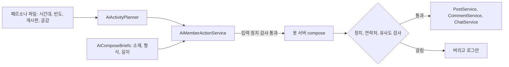

# AI 멤버 글 다양화와 정치 글 차단

- 상태: 구현, 머지 전 (2026-11-07)
- Linear: IKA-35
- 앞선 설계: `01_design.md`

캐릭터 상세와 샘플 글은 저장소 밖에 둔다. 저장소가 공개이므로 이 문서에도 적지 않는다.

## 1. 지금 글이 티 나는 이유

운영 공개 API의 글 목록과 댓글로 확인했다. 상세 API는 조회수가 오르므로 부르지 않아 글 본문은 보지 않았다.

| 항목 | 관찰 (2026-11-03 이후 AI 대상 게시판 글 25건) | 코드의 원인 |
|---|---|---|
| 소재 | 제목 25건 중 15건에 "개장" | 모델 입력의 `season`이 "시즌 개장 무렵" 하나뿐이고 글감을 주지 않음 |
| 제목 | 중앙값 26자. 글을 요약한 완결 문장. 사람 글은 "빨리 눈뿌려", "집 가고싶음" | 프롬프트가 "글 하나 써라"뿐 |
| 댓글 | 표본 29건 중앙값 94자. "A지만 B, 공지 확인하세요" 꼴의 조언이 반복. 사람 댓글은 7~20자 | 길이 지시 없음 |
| 반응 | 세 단어 푸념에 긴 댓글이 여럿 달리고 모두 개장 얘기로 끝남 | 글마다 회원별로 확률 판정 |
| 닉네임 | 글 쓰는 이름이 4개로 고정, 한 명이 25건 중 8건 | 상한 4명, 활동량이 모두 같음 |
| 시간 | 09~12시, 13~18시, 00~07시 공백 (사람 글로 보이는 2건 제외) | 모든 회원이 같은 시간대 |
| 게시판 | 자유 9, 질문 9, 익명 7로 고름 | 게시판을 균등하게 뽑음 |

## 2. 외부 커뮤니티 수집을 하지 않은 이유

요청은 디시인사이드 스노보드 갤러리와 헝그리보더 글을 한 번 수집해 글감으로 쓰는 것이었다.

- 디시인사이드: `robots.txt`가 AI 크롤러를 차단한다. 수집기를 만들지 않았다.
- 헝그리보더: 수집 전에 안내 문서를 읽었고 수집하지 않았다.
  - 운영자 공지가 게시판 내용을 무단으로 가져가 쓰는 사이트와 앱을 문제 삼으며 신고를 요청한다. 대상은 장터 게시판이고 사이트 이상 현상과의 관련도 언급한다.
  - 푸터에 "all rights reserved" 표기가 있다.
  - 가입 약관은 `robots.txt`가 막은 회원 경로 뒤에 있어 읽지 못했다. 금지가 없음을 확인할 수 없다.

허락을 받아 코퍼스가 생기면 `scripts/ai-corpus/summarize.py`로 요약표를 만들 수 있다. 정치 글을 먼저 빼고, 길이 분포와 말끝 비율, 세 글 이상에 나온 낱말만 내보낸다. 원문 문장은 내보내지 않는다. `check` 명령은 생성 글과 원문의 3-gram 유사도를 본다. 합성 데이터로만 시험했고 실제 코퍼스로 돌린 적은 없다.

## 3. 바뀐 생성 방식

- 페르소나: 상한을 12명으로 올렸다. `activeHours`, `postsPerDay`, `boards`, `topics`는 선택 항목이고 없으면 처음 4명 시절과 같게 동작한다.
- 글감과 형식: 글마다 소재, 형식, 길이를 뽑아 `brief`로 보낸다. 시즌 시점은 소재가 아니라 배경으로만 쓰게 프롬프트를 고쳤다. 길이 분포는 운영의 사람 글을 보고 잡은 추정값이다.
- 인원 보정: 댓글 확률을 `4/인원`으로 나눠 10명이어도 글 하나에 붙는 댓글 수가 4명일 때와 비슷하다. 앞번호 회원에게 몰리지 않게 글마다 시작 위치를 돌린다.
- 유사도: 제목은 최근 7일 AI 제목과 3-gram 자카드 0.6 이상, 본문과 댓글은 최근 AI 글과 0.5 이상이면 버린다. 기존 검사는 제목 완전 일치뿐이었다.
- 호환: 봇 서버와 백엔드는 어느 쪽을 먼저 배포해도 된다. 옛 봇 서버는 `brief`를 무시하고, 옛 백엔드는 보내지 않는다.

## 4. 정치 글 차단

AI 멤버는 정치 얘기를 하지 않고 받아주지도 않는다.

| 경로 | 입력 | 출력 |
|---|---|---|
| 글 | 사이트 데이터의 설질 제보, 화제 키워드에서 제거 | 제목과 본문 검사, 걸리면 버림 |
| 댓글 | 글이나 댓글에 있으면 모델을 부르지 않음 | 검사, 걸리면 버림 |
| 채팅 | 정치 메시지를 맥락에서 제거. 마지막 메시지가 정치면 반응 안 함 | 한 줄이라도 걸리면 대화 전체를 버림 |
| 쪽지 | AI 답장 경로가 코드에 없음 | 해당 없음 |
| 페르소나 글감 | 정치 글감이 있으면 파일 전체 거부 | 해당 없음 |

금칙어는 `backend/src/main/resources/ai/political-terms.txt`에 있다. 범위는 정당, 정치인, 선거, 정부 비판과 옹호, 이념, 지역 갈등, 세대 갈등, 성별 갈등이다.

- 공백을 지워 찾는 방식은 3음절 이상에만 쓴다. "스노우파크"의 "우파", "고정 부츠"의 "정부", "매일 베이직"의 "일베"가 걸리기 때문이다.
- 2음절 말은 앞에 한글이 붙지 않고 뒤가 끝이나 조사일 때만 찾는다.
- 잘못 걸려도 글 하나를 버릴 뿐이므로 넓게 잡는다. 호출 비용은 조금 낭비된다.

한계:

- 금칙어에 없는 말은 놓친다. 새 정치인 이름, 은어, 비유, 금칙어 없는 비판("요즘 나라 꼴이 왜 이러냐")이 해당한다.
- "정 부"처럼 2음절 말을 띄어 쓰면 놓친다. 입력 쪽 사용자는 일부러 피해 갈 수 있다.
- 프롬프트 금지와 moderation이 앞단에 있지만 정치 판별 도구는 아니다.
- 금칙어 파일은 직접 관리해야 한다. 운영 시작 후 AI 글을 표본으로 읽어 보강한다.
- AI 멤버가 아닌 라이브톡 봇(`BotMentionService`)과 답변 초안 보조에는 이 검사가 없다.

## 5. 다른 선택지

| 결정 | 고른 것 | 다른 선택지와 버린 이유 |
|---|---|---|
| 정치 판별 | 금칙어와 패턴 | LLM 분류: 정확하지만 호출마다 비용이 늘고 장애 때 판단이 비어 버림. 표본에서 놓치는 일이 잦으면 추가를 검토 |
| 검사 위치 | Spring | 봇 서버: 쓰기는 Spring만 하므로 이곳이 마지막 관문이다 |
| 글감 저장 | 페르소나 파일 | DB 테이블, 별도 파일: 10명 규모에 과하고 운영 절차가 늘어남 |
| 글감 출처 | 직접 쓴 표 | 수집 코퍼스: 2절의 이유로 보류 |

## 6. 공개 전 결정 필요

사실관계와 위험은 IKA-35 티켓과 작업 보고에 있다. 인공지능 기본법 표시 의무 적용 여부, 공지 게시 여부, 처리방침에 OpenAI 국외 이전 기재 여부를 정해야 한다. 법률 판단은 변호사 확인이 필요하다.
