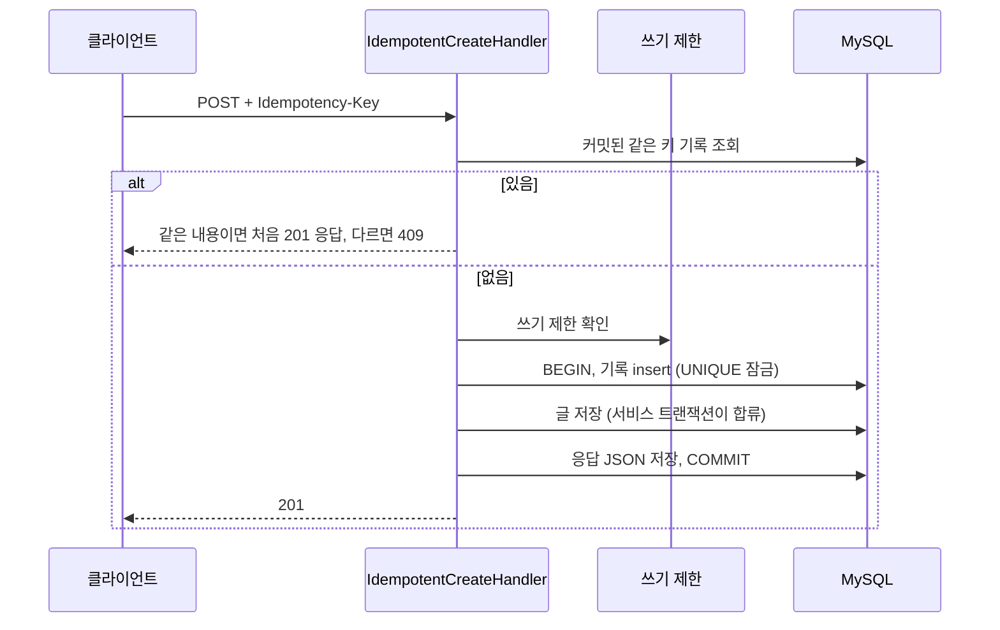

# 작성 API Idempotency-Key 설계

- 상태: 구현 (2026-11-05)
- 기준일: 2026-11-05 (KST)
- Linear: IKA-21
- 관련: IKA-19 작성 연타 제한(`ContentWriteRateLimiter`), IKA-12 답변 초안 멱등 키(`answer_draft.idempotency_key`, `request_hash`)
- API 명세: `docs/conception/sprint01/05.api-spec.md` 7절
- 마이그레이션: `database/production/032_migration_idempotency_record.sql`

## 1. 문제

IKA-19에서 프론트 동기 잠금과 작성자별 쓰기 제한(3초에서 10초 간격)을 넣었다. 쓰기 제한은 시간 간격만 보기 때문에 "같은 요청의 재전송"을 알아보지 못한다.

1. 사용자가 등록을 누른다. 서버는 글을 저장하고 커밋했다.
2. 응답이 모바일 네트워크에서 사라진다. 화면에는 "서버 통신 오류"가 뜬다.
3. 사용자가 간격이 지난 뒤 다시 누른다. 같은 글이 두 번 저장된다.

## 2. 목표와 범위

| 포함 | 제외 |
|---|---|
| 게시글, 댓글(대댓글 포함), 설질 제보, 카풀, 마켓 작성 API | 수정, 삭제 API (대상이 정해져 있어 다시 보내도 결과가 같다) |
| 공통 기록 표, 처리기, 만료 기록 정리 | Redis 도입 (MySQL로 먼저 설계, 도입은 별도) |
| 프론트 5개 작성 폼의 키 생성 | IKA-19 보류 항목 (Retry-After 헤더, IPv6 /64 묶음) |

헤더가 없는 요청은 예전과 똑같이 동작한다. AI 멤버 활동과 답변 초안 게시는 컨트롤러를 거치지 않고 서비스를 직접 부르므로 영향이 없다.

## 3. 데이터 모델

`idempotency_record` (032)

| 컬럼 | 타입 | 설명 |
|---|---|---|
| `idempotency_record_id` | BIGINT PK | |
| `author_key` | VARCHAR(80) bin | 회원은 `member:{회원 ID}`, 비로그인은 `ip:{IP SHA-256 앞 32자}`. IP 원문은 남기지 않는다 |
| `target_type` | VARCHAR(30) | `POST`, `COMMENT`, `RESORT_REPORT`, `CARPOOL`, `MARKET_LISTING` (CHECK) |
| `idempotency_key` | VARCHAR(36) bin | 소문자로 맞춘 UUID |
| `request_hash` | CHAR(64) | 요청 본문(댓글은 게시글 `publicId` 포함) JSON의 SHA-256 |
| `response_body` | MEDIUMTEXT NULL | 처음 201 응답 JSON. insert 직후에는 비어 있고 같은 트랜잭션 끝에서 채운다 |
| `created_at` | DATETIME(6) | KST |

- `UNIQUE(author_key, target_type, idempotency_key)`: 같은 요청의 두 번째 저장을 DB가 막는다.
- `INDEX(created_at, idempotency_record_id)`: 정리 스케줄러가 오래된 순으로 나눠 지울 때 쓴다.
- 답변 초안(`answer_draft`)은 초안 행 자체에 키를 두었다. 이번에는 대상이 다섯 종류라 공통 표 하나로 모았다. 각 글 표에 컬럼을 더하는 안은 표마다 마이그레이션과 인덱스가 늘고 정리 로직도 다섯 벌이 되어 뺐다.

## 4. 처리 흐름

`IdempotentCreateHandler.create()`가 컨트롤러에서 서비스 호출을 감싼다.

1. 헤더가 없으면 쓰기 제한 확인 후 서비스만 부른다 (기존 동작).
2. 키가 UUID 형식이 아니면 400 (`IDEMPOTENCY_001`).
3. 커밋된 같은 키 기록이 있으면 쓰기 제한을 거치지 않고 응답한다. 요청 해시가 같으면 처음 응답 바이트를 그대로 201로, 다르면 409 (`IDEMPOTENCY_002`).
4. 없으면 쓰기 제한을 확인하고, `TransactionTemplate` 한 트랜잭션 안에서 기록 insert, 서비스 호출, 응답 JSON 저장을 한다. 서비스의 `@Transactional`(REQUIRED)은 이 트랜잭션에 합류하므로 글과 기록이 함께 커밋되거나 함께 롤백된다.
5. 저장이 실패하면 기록도 롤백된다. 같은 키로 바로 다시 시도할 수 있다.

### 4.1 동시에 같은 키가 들어올 때

InnoDB에서 먼저 insert한 트랜잭션 A가 UNIQUE 인덱스 레코드에 배타 잠금을 쥔다. 같은 키를 insert하는 B는 그 잠금을 기다린다.

- A가 커밋하면 B는 중복 키 오류(`DataIntegrityViolationException`)를 받는다. B의 트랜잭션은 통째로 롤백되고, 처리기는 새 조회로 A의 기록을 읽어 같은 응답을 돌려준다.
- A가 롤백하면(검증 실패 등) B의 insert가 성공해 B가 정상 처리된다.
- B는 기록 insert에서 막히므로 글 저장, 외부 API 호출 같은 뒷일을 하지 않는다. 기록을 글 저장 뒤에 insert하는 안도 원자성은 같지만, B가 글을 다 만든 뒤 롤백하게 되어 뺐다.

동시성 테스트(`IdempotentCreateIntegrationTest.concurrentSameKeyCreatesOnce`)는 같은 키를 8개 스레드로 동시에 보내 글 1건, 기록 1건, 8개 응답이 모두 같은 `publicId`인지 확인한다.

### 4.2 재응답을 응답 JSON으로 저장한 이유

| 안 | 내용 | 결정 |
|---|---|---|
| A | 처음 응답 JSON을 저장했다가 바이트 그대로 돌려준다 | 채택 |
| B | 리소스 ID만 저장하고 재전송 때 다시 조회해 응답을 만든다 | 제외 |

- A는 처음 응답과 같은 바이트가 나가고, 도메인마다 재조회 로직을 만들 필요가 없다. 응답 DTO를 다시 객체로 바꾸지 않으므로 `ResortReportResponse`처럼 기본 생성자가 없는 DTO도 문제없다.
- B는 그 사이 글이 수정, 삭제되면 처음과 다른 응답이 나가고, 댓글 응답처럼 보는 사람 권한이 섞인 DTO는 다시 만들기 까다롭다.
- 대가: 기록 행이 응답 크기만큼 커진다. 응답은 몇 KB 수준이고 24시간 뒤 지운다.

### 4.3 응답 저장을 UPDATE 쿼리로 하는 이유

댓글 작성은 `postRepository.increaseCommentCount()`처럼 `clearAutomatically` 벌크 쿼리를 쓴다. 영속성 컨텍스트가 비워지면 기록 엔티티가 분리되어 변경 감지로는 응답이 저장되지 않는다. 그래서 `saveResponse()` JPQL UPDATE로 직접 쓴다. (대댓글 재전송 테스트가 이 문제를 잡았다.)

## 5. 쓰기 제한과의 순서

| 안 | 내용 | 결정 |
|---|---|---|
| A | 커밋된 기록 조회 → 쓰기 제한 → 트랜잭션 | 채택 |
| B | 쓰기 제한 → 기록 처리 (기존 순서 유지) | 제외 |
| C | 트랜잭션 안에서 기록 insert 뒤 쓰기 제한 | 제외 |

- B는 응답이 사라져 3초 안에 다시 누른 사용자가 429를 받는다. 재전송을 알아보려는 목표와 맞지 않는다.
- C는 같은 키 동시 요청도 모두 재응답을 받지만, 쓰기 제한이 `REQUIRES_NEW`로 두 번째 커넥션을 잡는다. 바깥 트랜잭션이 커넥션을 쥔 채 또 하나를 기다리면 풀이 바닥날 때 교착이 생길 수 있어 뺐다.
- A의 한계: 같은 키가 "동시에" 들어오면 두 번째 요청이 쓰기 제한 간격에 걸려 429를 받을 수 있다. 글은 1건만 저장되고, 프론트 동기 잠금이 동시 전송을 이미 막는다.

## 6. 트레이드오프와 영향

- **커넥션 점유**: 헤더가 있으면 서비스 전체가 한 트랜잭션에 들어간다. 원래 트랜잭션 밖에서 하던 익명 댓글 비밀번호 해시(bcrypt), 카풀 경로와 유가 외부 조회 동안에도 커넥션을 쥔다. 카풀은 시간당 10건 제한이라 영향이 작다. 서비스 파일을 고쳐 기록 insert를 안쪽 트랜잭션에 끼우는 안은 다섯 서비스(특히 병렬 작업 중인 댓글 작성 서비스)를 건드려 뺐다.
- **비로그인 작성자 키**: IP 기준이라 같은 공유기 뒤 사용자는 같은 작성자로 묶인다. 키가 무작위 UUID라 우연히 겹칠 일은 사실상 없다. 반대로 모바일에서 IP가 바뀐 뒤 재전송하면 새 요청으로 처리된다 (기존과 같음).
- **보관 기간 24시간**: 재시도는 길어야 몇 분 안이라 충분하다. 24시간이 지난 같은 키는 새 요청으로 처리된다.
- **AI 멤버, 답변 초안**: 컨트롤러를 거치지 않아 영향 없음.
- **CORS**: `allowedHeaders("*")`라 헤더 추가 설정이 필요 없다.

## 7. 정리 스케줄러

`IdempotencyRecordCleanupScheduler`가 매시 35분(KST)에 `created_at`이 24시간 지난 기록을 오래된 순으로 1,000건씩, 최대 50번 지운다. 한 번에 많이 지우면 잠금과 undo가 커지므로 짧은 트랜잭션으로 나눴다. 여러 인스턴스가 동시에 돌아도 같은 행을 지울 뿐이라 결과는 같다.

## 8. 프론트

`frontend/app/lib/idempotencyKey.ts`의 `useIdempotencyKey()`를 폼마다 하나씩 쓴다.

- `keyFor(body)`: 직전 시도와 본문이 같으면 같은 키, 다르면 새 키. 실패 후 같은 내용으로 다시 누르면 같은 키가 나가 서버가 재전송으로 알아본다. 내용을 고치면 새 키라 409에 걸리지 않는다.
- `reset()`: 성공하면 불러 다음 글이 새 키를 쓰게 한다.
- `crypto.randomUUID()`가 없는 환경(비보안 컨텍스트)에서는 `getRandomValues`로 v4 UUID를 만든다.
- 적용: 게시글 작성, 댓글(게시글 상세, 장터 상세, 공용 댓글 컴포넌트), 설질 제보(홈), 카풀 등록(수정 PUT은 제외), 마켓 등록.

## 9. 운영 적용 순서

1. 운영 DB에 032 마이그레이션 적용 (새 표라 이전 앱 이미지에 영향 없음)
2. 백엔드 배포 (`ddl-auto validate`가 표를 확인)
3. 프론트 배포. 이전 백엔드는 모르는 헤더를 무시하므로 순서가 바뀌어도 장애는 없다. 다만 멱등 처리는 백엔드가 나간 뒤부터 동작한다.
