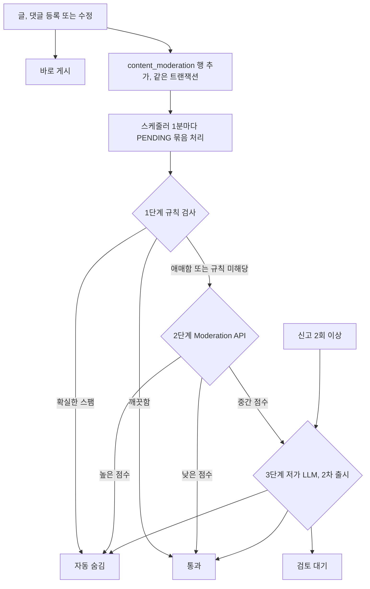

# AI 자동 검열 설계

- 상태: 설계 승인 (2026-11-11)
- 기준일: 2026-11-11 (KST)
- Linear: IKA-80
- 관련 설계: `docs/conception/025_content_report/01_design.md`(신고), `docs/conception/020_discord_notification/01_design.md`(Discord 알림, 일일 요약), `docs/conception/018_ai_members/01_design.md`(AI 회원), `docs/conception/017_admin_dashboard/`(관리자 화면)

## 1. 목적과 범위

운영자가 사이트를 계속 지켜보지 않아도 광고, 도박, 음란물, 욕설 글을 걸러 낸다. 비용은 거의 들지 않아야 한다. 비싼 AI 판정은 꼭 필요한 글에만 쓴다.

| 포함 | 제외 |
|---|---|
| 글, 댓글, 장터 글, 카풀 글, 설질 제보의 텍스트 | AI 회원이 쓴 글(생성할 때 이미 거른다) |
| 자동 숨김, 관리자 검토 대기열, 일일 요약 | 자동 삭제, 자동 정지 |
| 신고가 쌓인 글의 재판정 | 쪽지(1:1 대화 내용은 보내지 않는다) |

후속(3차): 장터와 글 이미지 검사, 라이브톡 메시지.

## 2. 흐름

- 사용자는 검사를 기다리지 않는다. 검사는 등록 트랜잭션 뒤에 비동기로 돈다.
- 검사 대기 행은 등록과 같은 트랜잭션에서 만든다. 검색 색인 outbox와 같은 방식이라, 서버가 재시작돼도 검사가 빠지지 않는다.

## 3. 단계

### 1단계: 규칙 검사 (비용 없음)

- 연락처, 외부 유도: 텔레그램, 오픈채팅 링크, 카카오톡 ID 표기, 짧은 URL 서비스
- 도박, 성인, 불법 키워드 목록 (설정 파일로 관리)
- 같은 내용 반복: 같은 작성자 또는 같은 IP가 내용 해시가 같은 글을 짧은 시간에 여러 번 등록
- 새 계정(가입 24시간 안)의 링크 여러 개
- 기존 `PoliticalContentFilter` 재사용 (정치 글은 숨기지 않고 검토 대기로 보낸다)

규칙에 걸린 "확실한 스팸"(도박 키워드와 외부 연락처가 함께 있는 경우 등)만 바로 숨긴다. 나머지는 2단계로 넘긴다. 규칙에 전혀 걸리지 않은 짧은 글(예: 20자 미만 댓글)은 2단계를 건너뛰어 호출 수를 줄인다.

### 2단계: OpenAI Moderation API (무료)

- `omni-moderation-latest`, 입력 배열로 한 번에 여러 건을 보낸다.
- 카테고리별 점수(harassment, hate, sexual, violence, illicit, self-harm 등)를 받아 임계값으로 나눈다.
  - 높음(예: sexual/minors 또는 illicit 0.9 이상): 자동 숨김
  - 중간(0.4~0.9): 검토 대기 (2차부터는 3단계로)
  - 낮음: 통과
- 임계값은 설정으로 둔다. 한국어 은어 판정 성능은 출시 전에 실제 글 표본(정상 50개, 문제 글 30개)으로 확인하고 조정한다.
- 무료지만 속도 제한이 있다. 실패하면 재시도 횟수를 늘려 다음 주기에 다시 처리하고, 계속 실패하면 검토 대기로 보낸다.

### 3단계: 저가 LLM 판정 (2차 출시, 유료)

- 대상: 2단계 중간 점수, 신고 2회 이상 쌓인 글
- 토큰 절약
  - 본문 앞 500자와 제목만 보낸다.
  - 고정된 짧은 지시문, 출력은 `{"verdict":"HIDE|REVIEW|PASS","reason":"..."}` 한 줄
  - 최대 10건을 한 요청에 묶는다.
  - 내용 해시로 결과를 저장해 같은 내용은 다시 묻지 않는다.
- 예상량: 하루 글과 댓글 200개 중 10%라면 하루 20건, 건당 약 400토큰. 월 비용은 몇백 원 수준이다.

## 4. 조치

| 판정 | 조치 | 작성자에게 보이는 것 |
|---|---|---|
| HIDE | 자동 숨김(기존 블라인드 상태 사용) | "운영 검토 중인 글입니다" |
| REVIEW | 그대로 두고 검토 대기열에 올림 | 변화 없음 |
| PASS | 기록만 남김 | 변화 없음 |

- AI는 삭제하거나 정지하지 않는다. 숨김까지만 한다.
- 작성자는 1:1 문의로 이의를 제기한다.
- 관리자가 "문제없음"으로 처리하면 숨김을 풀고, 같은 내용 해시는 다시 숨기지 않는다.

## 5. 데이터

`content_moderation` (마이그레이션 번호는 구현 시점에 정한다)

| 컬럼 | 설명 |
|---|---|
| content_moderation_id | PK |
| target_type | POST, COMMENT, MARKET, CARPOOL, RESORT_REPORT |
| target_id | 대상 ID |
| content_hash | 제목과 본문 정규화 후 SHA-256 |
| status | PENDING, DONE, FAILED |
| stage | RULE, MODERATION_API, LLM |
| verdict | PASS, REVIEW, HIDE |
| reasons | 걸린 규칙, 카테고리와 점수 (JSON, 본문은 넣지 않는다) |
| attempt_count, next_attempt_at | 재시도 |
| reviewed_by, reviewed_at, review_result | 관리자 처리 |
| created_at, updated_at | |

- 인덱스: `(status, next_attempt_at, content_moderation_id)` 처리용, `(verdict, reviewed_at, content_moderation_id)` 검토 대기열용, `(target_type, target_id)`
- 본문은 저장하지 않는다. 판정 근거만 남긴다.

## 6. 관리자와 알림

- 관리자 화면 "검토 대기" 메뉴(IKA-78 관리자 확장에 붙인다): 숨김과 검토 대기 목록, 이유, 원문 링크. 버튼: 문제없음, 숨김 유지, 삭제, 작성자 정지
- 일일 요약은 기존 Discord 일일 요약에 한 줄을 더한다: "어제 자동 숨김 N건, 검토 대기 M건". 새 메일 발송은 만들지 않는다.
- 자동 숨김이 한 시간에 10건을 넘으면 Discord #장애로 알린다(오판정 폭주 감지).

## 7. 개인정보와 키

- 이용자 글을 OpenAI(미국)로 보낸다. 개인정보처리방침에 처리 위탁과 국외 이전 항목을 더하고 새 방침 버전을 만든다. 1차 출시 전에 해야 한다.
- 보내는 내용은 제목과 본문뿐이다. 작성자 정보, IP, 연락처 칸은 보내지 않는다.
- OpenAI 키는 지금 봇 서버에만 있다. 백엔드 환경변수 `SNOWTHING_OPENAI_API_KEY`로 따로 넣는다(`compose.prod.yml`에도 추가). 봇 서버가 대기열을 가져가 처리하는 방식은 서버 사이 의존이 늘어 쓰지 않는다.
- 기능 스위치 `snowthing.moderation.enabled`, 단계별 스위치를 둔다. 키가 없으면 1단계만 돈다.

## 8. AI 회원

- AI 회원 글은 검사 대상에서 뺀다. 생성 단계에서 정치 필터와 규칙으로 이미 거른다.
- 판정 결과나 화면 어디에도 AI 회원을 따로 다룬다는 표시가 드러나지 않게 한다.

## 9. 출시 단계

| 단계 | 내용 | 비용 |
|---|---|---|
| 1차 | 대기열, 1단계 규칙, 2단계 Moderation API, 자동 숨김, 검토 대기 화면, Discord 요약, 개인정보처리방침 | 0원 |
| 2차 | 3단계 LLM(중간 점수, 신고 2회 이상) | 월 몇백 원 |
| 3차 | 이미지 검사(Moderation API 이미지 입력, 무료), 라이브톡 메시지 | 0원 |

## 10. 테스트

- 규칙: 패턴별 단위 테스트, 정상 글 오판정 표본
- 스케줄러: 묶음 처리, 실패 재시도, 서버 재시작 뒤 이어서 처리
- Moderation API: 클라이언트를 가짜로 바꿔 임계값 분기 확인. 실제 API 표본 시험은 출시 전에 따로 한다.
- 관리자: 비관리자 403, 문제없음 처리 시 숨김 해제
