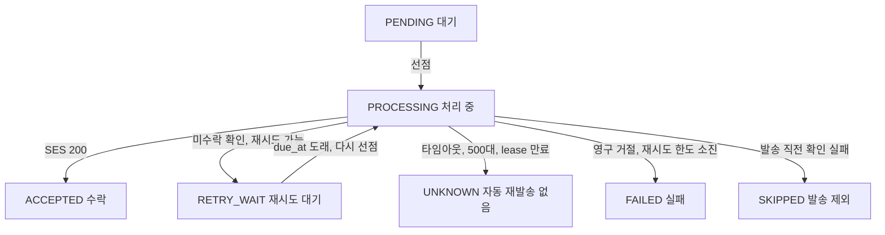

# 쪽지 도착 메일 알림

Sprint 8 미션(댓글 이메일 알림과 분산 환경의 데이터 정합성)을 쪽지 기준으로 바꿔 설계한다. 트랜잭션 방식 비교와 결과 불명 정책의 근거는 `ADR-3201-dm-mail-outbox.md`에 둔다.

## 배경

- 쪽지(`022_direct_message`)는 받은 사람이 쪽지함에 들어가기 전에는 도착을 알 수 없다. 쪽지에는 이벤트도 인앱 알림도 없다.
- `022_notification`에서 "이메일, 알림 끄기 설정"을 후속으로 미뤘다. 이번 설계가 그 후속이다.
- 메일은 이미 SES로 인증메일을 보내고 있다(`SesMailConfig`, `SesVerificationEmailSender`).
- 검색 색인은 `search_outbox`로 Outbox 패턴을 쓰고 있다. 다만 검색은 같은 작업을 다시 해도 결과가 같고, 메일은 다시 보내면 수신함에 한 통이 더 간다. 그래서 구조는 참고하되 재시도 정책은 새로 정한다.

## 목표

- 쪽지가 커밋되면 메일 발송 요청 기록도 반드시 남고, 쪽지가 롤백되면 기록도 없다.
- SES 호출은 쪽지 응답과 DB 트랜잭션 밖에서 한다. SES가 느리거나 죽어도 쪽지 보내기는 영향받지 않는다.
- SES가 수락했는지 알 수 없는 경우에는 자동으로 다시 보내지 않는다. 누락 가능성을 감수하고 중복을 피한다.

## 운영 전제

- 운영 서버 한 대, 기존 Spring Boot 프로세스 안의 폴링 워커 한 개, 기존 MySQL. Redis, SQS, 별도 서버는 만들지 않는다.
- 워커 두 개 실험은 격리 환경에서 같은 MySQL을 바라보는 로컬 프로세스 두 개로 한다. 다중 서버 운영이나 고가용성을 구축한 것이 아니다.
- 서버가 꺼져 있는 동안 발송은 멈춘다. DB가 남아 있으면 재기동 후 이어서 처리한다.

## 발송 정책

| 항목 | 결정 |
|---|---|
| 대상 | 새 쪽지가 오면 받는 사람에게 메일. 장터 쪽지도 포함한다 |
| 문구 | "A님에게서 쪽지가 도착했어요". 묶음이면 "A님, B님 외 1명에게서 쪽지 5개가 도착했어요". 쪽지함 링크를 넣는다 |
| 넣지 않는 것 | 쪽지 본문, 연락처. outbox에도 이메일 주소와 본문을 저장하지 않고 ID만 둔다 |
| 기본값 | 신규 회원 켜짐, 기존 회원 꺼짐 |
| 켜고 끄기 | 쪽지함 화면 토글. 메일 하단에 "알림 설정 바꾸기" 링크(쪽지함, 로그인 필요) |
| 묶음 | 첫 메일은 바로 보낸다. 이후 같은 받는 사람에게 10분 쿨다운 동안 온 쪽지는 모아서 한 통으로 보낸다 |
| 발송 직전 건너뛰기 | 받는 사람 탈퇴/정지, 알림 꺼짐, 이메일 미인증, 소셜 내부 대체 주소(`@users.invalid`), 이미 읽은 쪽지, 쪽지 생성 후 24시간 경과 |
| 쪽지 수정/삭제 | 새 발송 요청을 만들지 않는다 |

### 범위 밖

- 로그인 없이 메일에서 바로 끄는 원클릭 수신거부. 링크 미리열기(보안 스캐너)로 잘못 꺼지지 않게 하려면 확인 페이지, 비로그인 POST API, 서명 토큰이 필요해 별도 작업으로 둔다.
- 차단 관계 기반 건너뛰기. 차단된 사람은 이미 쪽지를 보낼 수 없어서, 문제가 되는 경우는 차단 전에 보냈고 쿨다운 안에서 아직 메일이 나가지 않은 쪽지뿐이다. 이 한계를 감수한다.
- 원클릭 해제, 다이제스트 메일 템플릿 고도화, 댓글 메일.

### 한계

- 이미 나간 메일은 쪽지 삭제나 알림 끄기로 되돌릴 수 없다.
- ACCEPTED는 SES가 요청을 받았다는 뜻이지, 수신함에 도착했다는 뜻이 아니다.

## 데이터 모델

마이그레이션 `database/production/052_migration_dm_mail_notification.sql`. 기존 테이블을 바꾸지 않고 새 테이블만 만든다.

### member_notification_setting

```
member_id         BIGINT PK (member FK)
dm_email_enabled  BOOLEAN NOT NULL
updated_at        DATETIME NOT NULL
```

- 행이 없으면 꺼짐으로 해석한다. 기존 회원은 행이 없으므로 꺼짐이고, 마이그레이션에서 member 테이블을 UPDATE하지 않는다.
- 일반 가입(`VerifiedMemberRegistrationService`)과 소셜 가입(`SocialAuthService`)에서 `true`로 행을 만든다. 한 곳을 빠뜨려도 원치 않는 메일은 나가지 않는 쪽으로 틀린다.
- member 컬럼 대신 별도 테이블로 둔 이유: 기존 행 전체 UPDATE가 필요 없고, 알림 설정은 알림 도메인의 관심사이며, 나중에 다른 알림 끄기 설정을 컬럼으로 더할 수 있다. 대가는 발송 직전 확인의 PK 조인 하나다.
- `member_registration_consent`(가입 당시 동의 기록)에는 합치지 않는다. 바뀌는 설정값이 들어가면 기록의 의미가 흐려진다.

### dm_mail_outbox

쪽지 1개에 행 1개.

```
event_id             BIGINT PK AUTO_INCREMENT
direct_message_id    BIGINT NOT NULL
recipient_member_id  BIGINT NOT NULL
event_type           VARCHAR(30) NOT NULL   -- DM_RECEIVED
channel              VARCHAR(20) NOT NULL   -- EMAIL
status               VARCHAR(20) NOT NULL
attempts             INT NOT NULL
due_at               DATETIME(6) NOT NULL
lease_until          DATETIME(6) NULL
claim_token          CHAR(36) NULL
provider_message_id  VARCHAR(100) NULL
skip_reason          VARCHAR(30) NULL
last_error_code      VARCHAR(100) NULL
created_at           DATETIME(6) NOT NULL
updated_at           DATETIME(6) NOT NULL

UNIQUE uk_dm_mail_outbox_intent (direct_message_id, recipient_member_id, event_type, channel)
INDEX  idx_dm_mail_outbox_due (status, due_at, event_id)
INDEX  idx_dm_mail_outbox_recipient (recipient_member_id, status)
```

- 유니크 제약은 같은 쪽지에 발송 요청이 두 번 생기는 것을 막는다. 사용자가 전송을 두 번 눌러 쪽지 자체가 두 개 생기는 것은 막지 못한다.
- 메일 한 통이 여러 행을 묶으면 `provider_message_id`가 그 행들에 같은 값으로 들어간다. 어떤 쪽지가 어떤 SES 메일로 나갔는지 추적하는 키다.
- 인덱스는 구현 후 실제 데이터로 `EXPLAIN`을 확인한다.

### dm_mail_recipient_state

```
recipient_member_id  BIGINT PK
last_attempt_at      DATETIME(6) NULL
```

- 쿨다운의 기준 시각을 담는다.
- 같은 받는 사람을 두 워커가 동시에 묶지 못하게 하는 잠금 지점이다. outbox 행에만 `SKIP LOCKED`를 걸면 받는 사람 한 명의 행 5개를 워커 A가 3개, 워커 B가 2개 잡아 묶음 메일이 두 통으로 쪼개질 수 있다.

### 회원 탈퇴

`025_member_withdrawal`의 삭제 목록에 새 테이블을 더한다. `MemberWithdrawalService`가 같은 트랜잭션에서 지운다.

| 테이블 | 처리 |
|---|---|
| `member_notification_setting` | 행 삭제 |
| `dm_mail_outbox` | 받는 사람이 탈퇴 회원인 행 삭제 |
| `dm_mail_recipient_state` | 행 삭제 |

- 이미 워커가 PROCESSING으로 잡은 행이 지워지면 결과 기록의 영향 행 수가 0이 되어 늦은 워커와 같은 경로로 기록을 포기한다. 지워지기 전에 시작한 SES 호출은 막지 못한다.
- 탈퇴 회원이 보낸 쪽지의 outbox 행은 남긴다. 발송 직전 확인에서 받는 사람 기준으로만 판단하고, 보낸 사람 표시 이름은 기존 쪽지 화면의 탈퇴 회원 표시 규칙을 따른다.

## 트랜잭션과 워커 흐름

```
[1. 쪽지 TX] DirectMessageService.send()
   direct_message INSERT
   받는 사람 설정이 켜져 있으면 dm_mail_outbox INSERT (PENDING, due_at = now)
   → 커밋 → 응답
   outbox INSERT가 실패하면 쪽지도 롤백한다.

[폴링 시작] 워커 (1초 간격)
   a. lease가 지난 PROCESSING 행 → UNKNOWN (자동 재발송 없음)
   b. PENDING 또는 RETRY_WAIT이고 due_at <= now인 행이 있는 받는 사람을 최대 5명 고른다
   c. 받는 사람 한 명씩 아래 2~4를 차례로 한다

[2. 선점 TX] 받는 사람 한 명
   dm_mail_recipient_state 행을 FOR UPDATE SKIP LOCKED로 잡는다 (행이 없으면 만든 뒤 잡는다)
        이미 잡혀 있음 → 다른 워커 담당, 건너뛴다
        last_attempt_at이 쿨다운(10분) 안 → 그 사람의 대기 행 due_at을
                                             last_attempt_at + 10분으로 미루고 끝
   그 사람의 보낼 수 있는 행 전부 → PROCESSING, 같은 claim_token, lease_until = now + 60초
   last_attempt_at = now
   → 커밋

[3. 트랜잭션 없음]
   발송 직전 확인 (회원 상태, 설정, 이메일, 쪽지 읽음, 24시간)
   건너뛸 행은 4단계에서 SKIPPED로 기록하고, 남은 쪽지가 없으면 SES를 부르지 않는다
   남은 쪽지로 메일 한 통 → SES SendEmail 1회 (SDK 재시도 0회)

[4. 결과 TX]
   UPDATE dm_mail_outbox SET status = ?, ...
    WHERE event_id IN (...) AND status = 'PROCESSING' AND claim_token = ?
   바뀐 행 수가 잡은 행 수와 다르면 늦은 워커로 보고 기록을 포기하고 경고 로그를 남긴다
```

- 2와 4를 짧게 나누는 이유: SES 호출 동안 DB 커넥션과 행 잠금을 쥐고 있으면 SES가 느려질 때 쪽지 API까지 커넥션을 기다리게 된다.
- 선점 커밋 뒤에는 행 잠금이 풀린다. 그 뒤 소유권은 `status`, `claim_token`, `lease_until`로 판단한다.
- 조건부 갱신(CAS)은 늦은 DB 기록만 막는다. 이미 시작한 SES 호출은 취소하지 못한다.
- 받는 사람을 한꺼번에 선점하지 않고 한 명씩 선점, 발송, 기록한다. 여러 명을 먼저 잡고 차례로 보내면 뒤쪽 작업의 lease가 앞 작업의 SES 호출을 기다리는 동안 줄어들어, 호출하기도 전에 끝나 UNKNOWN이 될 수 있다. 한 명씩이면 lease 60초는 SES 호출 한 번(전체 5초)만 감당하면 된다.
- 메일이 나가지 않았음이 확실한 경우(SKIPPED만 있음, RETRY_WAIT, FAILED 영구 거절, 발송 준비 실패)에는 `last_attempt_at`을 선점 전 값으로 되돌린다. 재시도가 쿨다운에 막히지 않게 하기 위해서다. 되돌릴 때도 선점 때 쓴 값과 같을 때만 바꾼다.
- SES를 부르기 전 단계(대상 조회, 문구 생성)에서 예외가 나면 메일은 나가지 않았으므로 RETRY_WAIT로 돌린다.
- DB URL에 `useAffectedRows=true`가 있어 영향 행 수가 실제로 바뀐 행 기준이다.
- 시간은 KST, `Clock` 빈 기준으로 통일한다.

## 상태 머신



RETRY_WAIT 행은 선점 대상에 PENDING과 함께 포함한다. `skip_reason` 값과 판단 순서는 `EXPIRED`, `RECIPIENT_INACTIVE`, `NOTIFICATION_OFF`, `EMAIL_UNDELIVERABLE`, `ALREADY_READ`, `MESSAGE_MISSING`(쪽지 행이 없음)이다.

## 실패 정책

| 상황 | 판단 근거 | 상태 |
|---|---|---|
| SES 200 | MessageId를 받음 | ACCEPTED |
| 연결 거부, DNS 실패 | 요청이 나가지 않았음이 확실함 | RETRY_WAIT |
| 429 TooManyRequests | 공급자가 명시적으로 나중에 하라고 거절함 | RETRY_WAIT |
| 400대 거절 (주소 거부, 계정 정지, 설정 오류) | 다시 보내도 같은 결과 | FAILED |
| 응답 타임아웃, 500대 | 수락했는지 알 수 없음 | UNKNOWN |
| PROCESSING인데 lease 만료 | 호출 전후 어디서 멈췄는지 모름 | UNKNOWN |
| 쪽지 롤백 | outbox도 롤백 | 행 없음 |
| 커밋 후 워커 시작 전 재시작 | DB에 행이 남음 | 재기동 후 처리 |

- 재시도는 최대 5회다. 백오프는 30초부터 두 배씩, 상한 10분이고, 백오프 값의 절반에서 전체 사이를 무작위로 고른다(equal jitter). full jitter는 0에 가까운 대기가 나올 수 있어 쓰지 않았다. 24시간 기한이 재시도보다 우선한다.
- 연결 단계 실패로 보는 예외는 원인 사슬에 `ConnectException`, `UnknownHostException`, `NoRouteToHostException`, `ConnectTimeoutException`이 있는 경우다. 그 밖에 응답을 받지 못한 예외는 모두 UNKNOWN이다.
- 500대를 재시도하지 않는 이유와 누락 대신 중복을 피한 근거는 ADR에 둔다.
- 예외 이름만으로 미수락을 단정하지 않는다. 연결 단계 실패와 응답 대기 중 실패를 구분한다.
- UNKNOWN과 FAILED는 운영자가 근거를 확인해 정리한다. 상태 정리와 외부 재발송은 별도 결정이다.

## SES 클라이언트

- 쪽지 메일 전용 `SesV2Client` 빈을 만든다. SDK 재시도는 0회로 한다. SDK가 몰래 재시도하면 앱이 모르는 중복이 생기기 때문이다.
- 시도당 3초, 전체 5초 제한은 `SesMailConfig`와 같은 값으로 둔다. 설정(`snowthing.dm-mail.ses.*`)으로 바꿀 수 있고, 테스트는 짧게 줄인다.
- `snowthing.mail.provider`가 `ses`가 아니면 발송하지 않는 발송기를 쓰고, 워커는 작업을 잡지 않는다. 행은 PENDING으로 남는다. 나중에 공급자를 켜고 워커가 잡을 때, 생성 후 24시간이 지난 행은 SKIPPED(EXPIRED)가 된다.
- 인증메일 클라이언트와 `SesVerificationEmailSender`는 바꾸지 않는다. 쪽지 메일을 인증메일 클래스에 끼워 넣지 않는다.

## API와 화면

```
GET /api/v1/members/me/notification-settings
→ 200 { "dmEmailEnabled": true, "emailDeliverable": true }

PUT /api/v1/members/me/notification-settings
{ "dmEmailEnabled": false }
→ 200 { "dmEmailEnabled": false, "emailDeliverable": true }
```

- `emailDeliverable`은 이메일이 인증돼 있고 소셜 내부 대체 주소가 아닐 때 true다.
- 쪽지함 상단에 "쪽지 오면 메일로 알림" 토글을 둔다. `emailDeliverable`이 false면 토글을 비활성화하고 받을 수 있는 이메일이 없다고 안내한다.
- 메일 하단 링크는 쪽지함으로 연결한다.

## 운영 설정

| 키 | 운영 기본값 | 설명 |
|---|---|---|
| `snowthing.dm-mail.enqueue-enabled` | false | outbox 적재 |
| `snowthing.dm-mail.send-enabled` | false | 워커 발송 |
| `snowthing.dm-mail.cooldown` | 10m | 같은 받는 사람 묶음 간격 |
| `snowthing.dm-mail.deadline` | 24h | 쪽지 생성 후 발송 포기 시점 |
| `snowthing.dm-mail.lease` | 60s | 선점 유지 시간 |
| `snowthing.dm-mail.max-attempts` | 5 | 재시도 한도 |

- 적재를 먼저 켜서 행이 쌓이는 것을 확인하고, 발송은 승인된 테스트 수신자로 별도 확인 후 켠다. 24시간 기한이 있어 발송을 켤 때 오래된 건이 한꺼번에 나가지 않는다.
- 운영 env를 추가할 때 `compose.prod.yml`에도 넣는다.
- 로그에는 eventId와 오류 분류만 남긴다. 이메일, 본문, 비밀값은 남기지 않는다.
- 대기 건수, 가장 오래된 대기 시간, UNKNOWN과 FAILED 건수는 관리자 요약 `GET /api/v1/admin/dm-mail/outbox/summary`로 본다. 검색 outbox 요약과 같은 방식이다. 상태를 바꾸는 관리자 API는 두지 않는다.
- ACCEPTED와 SKIPPED 행은 30일 뒤 매일 04:40에 1000행씩 지운다. UNKNOWN과 FAILED는 운영 확인용으로 남긴다.
- 성능 비교용 `snowthing.dm-mail.delivery-mode=sync-baseline`이 있다. 쪽지 트랜잭션 안에서 SES를 바로 부르는 기준선이며, 벤치마크 테스트에서만 켠다.

## 검증

### 자동 테스트

테스트는 실제 MySQL(`snowthing_test`)로 돈다. 가짜 SES는 JDK 내장 `HttpServer`로 만들고 쪽지 메일 클라이언트의 endpoint를 바꿔 연결한다. 가짜 서버가 받은 HTTP 요청 수와 수락 건수를 따로 센다.

| 묶음 | 케이스 | 기대 |
|---|---|---|
| 원자성 | 쪽지 커밋 | 쪽지 1개, outbox 1행 |
| | 쪽지 저장 후 예외 | 쪽지 0개, outbox 0행 |
| | outbox INSERT 실패 | 쪽지도 롤백 |
| | 같은 쪽지 중복 적재 | 1행 |
| 설정 | 기존 회원(설정 행 없음) | 적재 안 됨 |
| | 일반 가입, 소셜 가입 | 설정 행 true |
| | 적재 후 알림 끔 | SKIPPED, SES 호출 0회 |
| 묶음 | 쪽지 5개 연속 | 즉시 1통(1개), 쿨다운 뒤 1통(4개) |
| | 쿨다운 중 읽음 | 읽은 쪽지 제외, 전부 읽으면 호출 0회 |
| 상태 | SES 200 | ACCEPTED, 묶인 행에 같은 MessageId |
| | 연결 거부, 429 | RETRY_WAIT, attempts 증가, due_at 백오프 |
| | 400 | FAILED |
| | 타임아웃 A (수락 전 끊김) | UNKNOWN, 수락 0건, 자동 재발송 0회 |
| | 타임아웃 B (수락 후 응답 유실) | UNKNOWN, 수락 1건, 자동 재발송 0회 |
| | lease 만료 | UNKNOWN |
| | 24시간 경과 | SKIPPED(EXPIRED) |
| SDK | 429, 500 응답 | 가짜 SES가 받은 요청 정확히 1번 |
| 경합 | 워커 두 개 동시 선점 | 받는 사람마다 한 워커만, 묶음이 쪼개지지 않음 |
| | 늦은 워커 | 결과 UPDATE 영향 행 0, 기록 거부 |
| 재시작 | 커밋 후 워커 미실행, 새 처리기 실행 | 남은 행 처리 |

### 수동 실험

결과는 `02_verification.md`에 이벤트 ID별 HTTP 요청 수, 공급자 수락 수, 최종 DB 상태로 적는다.

- 같은 MySQL과 가짜 SES에 연결한 앱 프로세스 두 개로 경합 확인
- 쪽지 커밋 직후 프로세스 강제 종료 후 재기동
- SES 수락 직후 프로세스 종료

### 성능 비교

결과는 `03_benchmark.md`에 적는다.

- benchmark 프로필에서만 켜지는 "쪽지 TX 안에서 동기 발송" 버전을 기준선으로 둔다.
- 가짜 SES 지연을 고정하고 쪽지 API p50/p95, 오류율, outbox 적재부터 수락까지의 지연, 처리량, 대기 건수와 가장 오래된 대기 시간을 비교한다.
- 표본이 적으면 p99는 적지 않는다. 측정하지 않은 값은 빈칸으로 둔다.

### 명령

- 백엔드 `./gradlew spotlessCheck test`
- 프론트 `npm run lint`, `npm run build`
