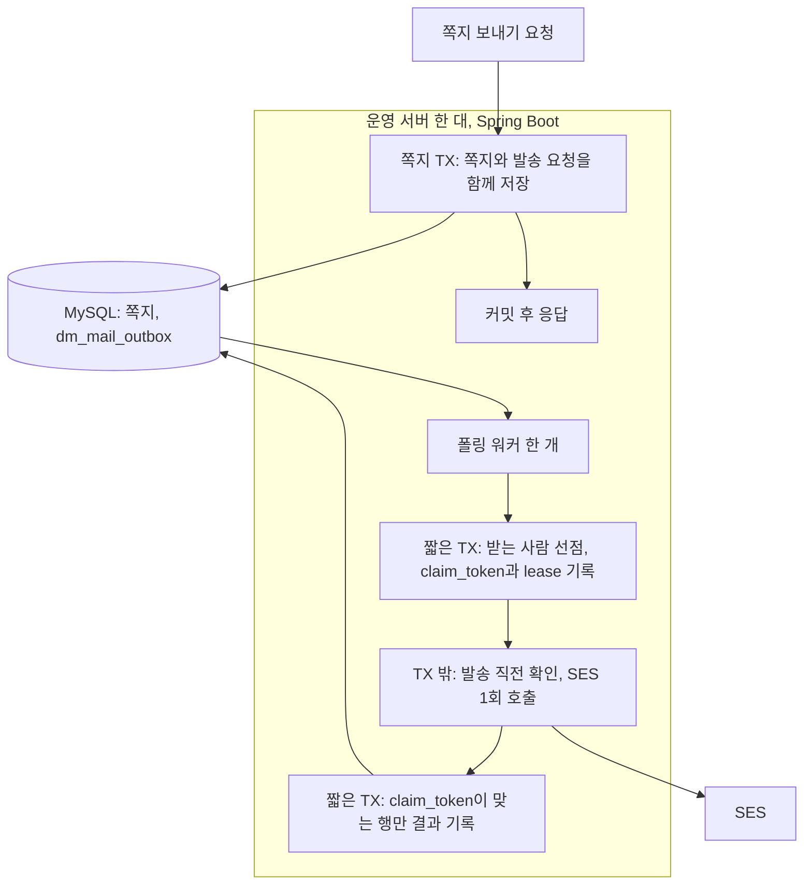

# ADR-3201 쪽지 도착 메일의 발송 방식과 결과 불명 정책

- 상태: Accepted
- 결정일: 2026-11-17
- 대상: `DirectMessageService.send`, `com.ikae.snowthing.domain.dmmail`, `dm_mail_outbox`, `dm_mail_recipient_state`, `member_notification_setting`
- 운영 전제: EC2 1대, 프로세스 안 폴링 워커 1개, RDS MySQL 8.0, SES. Redis, SQS, 별도 서버는 만들지 않는다.
- 실험 환경: 로컬 Docker MySQL 8.0, 가짜 SES HTTP 서버, 격리 DB `snowthing_test`, `snowthing_ika88_exp`
- 설계: `01_design.md`, 검증: `02_verification.md`, 측정: `03_benchmark.md`

## 문제

쪽지를 받은 사람은 쪽지함에 들어가기 전에는 도착을 알 수 없다. 쪽지가 오면 받는 사람의 이메일로 "OO님에게서 쪽지가 도착했어요"라는 알림을 보낸다. 쪽지 본문은 메일에 넣지 않는다.

쪽지는 MySQL에 저장하고 메일은 SES로 보낸다. 두 시스템은 하나의 트랜잭션으로 묶을 수 없다. 그래서 두 가지 실패가 생긴다.

1. 쪽지는 저장됐는데 발송 요청이 사라진다. 메일 호출을 커밋 뒤 메모리에서 처리하면, 그 사이 앱이 꺼질 때 무엇을 보내야 했는지 기록이 남지 않는다.
2. SES가 메일을 수락한 뒤 응답만 사라진다. 앱은 타임아웃만 보고, DB만 봐서는 다시 보내도 되는지 알 수 없다.

앞의 문제는 발송 방식의 문제이고, 뒤의 문제는 외부 호출 결과를 다루는 정책의 문제다. 이번 결정은 메일을 붙이는 데 목적을 두지 않는다. 쪽지 커밋과 발송 요청 기록은 함께 보장하고, 외부 메일 호출은 쪽지 응답과 DB 트랜잭션에서 떼어 내는 것이 목적이다.

## 불변식

- 커밋된 쪽지 중 받는 사람이 알림을 켜 둔 쪽지에는 발송 요청 행이 정확히 1개 있다.
- 롤백된 쪽지에는 발송 요청 행이 없다.
- 같은 쪽지, 받는 사람, 이벤트 종류, 채널의 발송 요청은 최대 1개다.
- SES 호출은 DB 트랜잭션 밖에서 한다. 쪽지 트랜잭션 안에서 SES를 기다리지 않는다.
- PROCESSING 행의 결과는 그 행을 선점한 워커(같은 claim_token)만 기록한다.
- 같은 받는 사람의 대기 행은 한 시점에 한 워커만 선점한다.
- 수락 여부를 알 수 없는 발송은 자동으로 다시 보내지 않는다.

## 실패 재현

### 동기 호출의 지연 전파

쪽지 트랜잭션 안에서 SES를 바로 부르는 동기 기준선을 만들어 Outbox와 같은 조건으로 쟀다. 가짜 SES 응답 지연 1000ms, 요청 60건, 동시 6, DB 커넥션 풀 5다.

| 방식 | p50 | p95 | 최대 | 60건 전체 | 오류 |
|---|---:|---:|---:|---:|---:|
| 동기 기준선 | 1,038ms | 1,965ms | 2,049ms | 12.3초 | 0 |
| Outbox | 14ms | 30ms | 46ms | 0.18초 | 0 |

동기 기준선은 SES 지연 1초가 쪽지 응답에 그대로 더해졌다. p95가 2초 가까운 것은 요청 5개가 SES를 기다리는 동안 커넥션을 쥐고 있어 여섯 번째 요청이 커넥션을 1초 가까이 기다렸기 때문이다. SES가 느려지면 쪽지와 상관없는 API까지 커넥션을 기다리게 된다. 동기 호출은 메일이 나간 뒤 쪽지 트랜잭션이 롤백될 수도 있다.

### 타임아웃은 실패가 아니다

가짜 SES로 두 경우를 만들었다.

| 케이스 | 공급자 동작 | 앱이 본 결과 | 공급자 수락 |
|---|---|---|---:|
| A | 수락하지 않고 응답을 끊음 | 타임아웃 | 0 |
| B | 수락한 뒤 응답을 끊음 | 타임아웃 | 1 |

앱에서 두 경우를 구분할 수 없다. 둘 다 다시 보내고 다음 요청이 성공하면 A는 총 1건, B는 총 2건이 된다. 재발송은 A를 복구하는 동시에 B를 중복시킨다.

측정 첫 실행에서는 테스트용 짧은 제한 시간(전체 0.9초)으로 가짜 SES 지연 1초를 부르는 실수를 했다. Outbox 60건이 모두 타임아웃으로 끝났는데 가짜 SES는 그중 59건을 실제로 수락했다. 케이스 B가 대량으로 재현된 것이다. 이 실행은 성능 수치에서 제외했다.

## 후보 비교

### 발송 방식

| 후보 | 쪽지 응답 | 커밋 후 앱 종료 | 이중 쓰기 | 추가 인프라 |
|---|---|---|---|---|
| A. 요청 중 동기 호출 | SES 지연이 더해짐(p95 1,965ms) | 메일이 나간 뒤 롤백 가능 | 있음 | 없음 |
| B. AFTER_COMMIT + 비동기 실행기 | 빠름 | 커밋 후 제출 전, 큐 대기 중 작업이 사라짐 | 있음 | 없음 |
| C. Redis Streams | 빠름 | Redis 적재 전 종료 시 사라짐 | MySQL 커밋과 Redis 적재 사이에 남음 | Redis |
| D. SQS Standard | 빠름 | C와 같음 | C와 같음 | SQS |
| E. MySQL Outbox + 폴링 | 빠름(p95 30ms) | DB 행이 남아 재기동 후 처리 | 없음 | 없음 |

- B: AFTER_COMMIT은 실행 시점을 정할 뿐 비동기 실행이나 내구성을 주지 않는다. 비동기 실행기까지 붙여도 메모리에만 있는 작업은 재시작 때 사라진다. 기존 인앱 알림(`NotificationEventListener`)이 이 방식이고, 저장 전에 프로세스가 끝나면 재처리 기록이 없다.
- C, D: 소비자 그룹, ACK, 재전달로 전달 이후를 보완하지만 MySQL 커밋과 큐 적재는 여전히 따로 쓴다. 발송 의도를 보존하는 방법이 아니라 그 다음 전달 경로다. 중복 소비와 SES 결과 불명도 그대로 남는다. 서버 한 대에서는 들일 이유가 없다.
- E: 쪽지와 발송 의도를 같은 DB 트랜잭션에 저장해 둘 사이의 실패 구간을 없앤다. 대신 폴링 지연과 DB 부하, 행 정리 비용이 생긴다.

### 결과 불명 정책

무엇을 세는지부터 정한다. 기준은 같은 발송 요청에 대한 SES 수락 횟수다. outbox 행 수, 워커 실행 횟수, HTTP 요청 수, 수락 수, 수신함 도착 수는 서로 다르다.

| 후보 | 수락 횟수 | 대가 |
|---|---|---|
| 최소 한 번: 타임아웃이면 다시 보냄 | 1 이상 | 케이스 B에서 중복 |
| 최대 한 번에 가깝게: 결과 불명은 UNKNOWN, 자동 재발송 없음 | 0 또는 1 | 케이스 A에서 누락 |
| 정확히 한 번 | 정확히 1 | SES SendEmail에는 워커가 넣을 수 있는 요청 멱등 키가 문서에 정의돼 있지 않다. 공급자 계약 없이 주장할 수 없다 |

### 쪽지 묶음 방식

같은 받는 사람에게 쪽지가 연달아 오면 첫 메일은 바로 보내고 이후 10분 동안 온 쪽지는 한 통으로 묶는다. 쪽지 N개가 메일 1통이 되는 지점이 생긴다.

| 후보 | 방식 | 대가 |
|---|---|---|
| X | 쪽지마다 행 하나. 워커가 받는 사람 단위로 여러 행을 함께 선점 | 선점과 결과 기록이 여러 행 단위 |
| Y | 받는 사람마다 대기 행 하나. 쪽지 TX에서 개수를 올림 | 부분 유니크 인덱스가 없어 생성 컬럼 꼼수 필요, 쪽지 TX 안에서 같은 행 잠금 경합, 쪽지별 추적 불가 |

## 결정

발송은 MySQL Transactional Outbox와 프로세스 안 폴링 워커 하나로 한다. 트랜잭션은 세 구간으로 나눈다.

- 발송 요청 쓰기는 `Propagation.MANDATORY`다. 트랜잭션 밖에서 부르면 바로 실패한다. 쪽지와 발송 요청을 `REQUIRES_NEW`로 나누면 둘 중 하나만 커밋될 수 있다.
- 발송 요청 쓰기가 실패하면 쪽지도 롤백한다. 쪽지만 성공시키는 정책을 택하면 자동 복구할 수 있는 발송 기록을 보장하지 못한다.
- 발송 요청에는 쪽지 ID와 받는 사람 ID만 둔다. 이메일 주소와 본문은 저장하지 않고, 발송 직전에 회원 상태, 설정, 받을 수 있는 주소, 읽음 여부, 24시간 기한을 다시 확인한다.
- 다중 워커 조율은 받는 사람 상태 행의 `SELECT ... FOR UPDATE SKIP LOCKED`로 한다. JVM 락으로는 프로세스 두 개를 조율할 수 없다. 받는 사람을 한 명씩 선점, 발송, 기록하므로 lease 60초는 SES 호출 한 번(전체 5초)만 감당하면 된다.
- 선점 커밋 뒤에는 행 잠금이 풀린다. 소유권은 `status`, `claim_token`, `lease_until`이다. 결과 기록은 `WHERE status = 'PROCESSING' AND claim_token = ?` 조건부 갱신이고, 영향 행 수가 잡은 행 수와 다르면 늦은 워커로 보고 기록을 포기한다. 모든 JDBC 환경에 `useAffectedRows=true`를 유지한다.

결과 불명 정책은 미수락이 확실한 경우만 제한적으로 재시도한다.

| 상황 | 판단 근거 | 상태 |
|---|---|---|
| SES 200 | MessageId를 받음 | ACCEPTED |
| 연결 거부, 주소 해석 실패, 연결 제한 시간 | 요청이 나가지 않았음이 확실함 | RETRY_WAIT |
| 429 | 공급자가 명시적으로 나중에 하라고 거절함 | RETRY_WAIT |
| 그 밖의 400대 | 다시 보내도 같은 결과 | FAILED |
| 응답 대기 중 타임아웃, 500대 | 수락했는지 알 수 없음 | UNKNOWN |
| PROCESSING인데 lease 만료 | 호출 전후 어디서 멈췄는지 모름 | UNKNOWN |

묶음은 X로 한다. 적재는 쪽지 단위로 원자적으로, 발송은 받는 사람 단위로 묶는다고 경계를 나눌 수 있다. 받는 사람 상태 행 하나를 잠그면 담당 워커가 하나로 정해져 묶음이 쪼개지지 않는다.

ACCEPTED는 SES가 요청을 받았다는 뜻이지 수신함에 도착했다는 뜻이 아니다.

## 선택안의 단점

- 워커 하나가 받는 사람을 차례로 처리해 처리량은 대략 1 / SES 응답 시간이다. SES 지연 1초, 60건 동시 적재에서 알림은 적재부터 수락까지 p95 57.9초가 걸렸다.
- 폴링 간격만큼 알림이 늦어지고 폴링 쿼리가 계속 나간다.
- 쪽지마다 INSERT가 하나 늘고, 끝난 행을 정리해야 한다. ACCEPTED와 SKIPPED는 30일 뒤 지우고 UNKNOWN과 FAILED는 남긴다.
- 케이스 A처럼 수락 전에 끊긴 메일은 누락된다.
- 메일 한 통의 결과를 묶인 행 전부에 같은 값으로 적는다. 한 통이 UNKNOWN이면 묶인 쪽지 전부가 UNKNOWN이다.
- 조건부 갱신은 늦은 DB 기록만 막는다. lease가 끝난 뒤 옛 워커가 이미 시작한 SES 호출은 취소하지 못한다.

쪽지 알림은 놓쳐도 쪽지함에서 확인할 수 있고, 같은 알림이 두 통 오는 것이 사용자 신뢰와 스팸 신고에 더 나쁘다. 쪽지 메일과 회원가입 인증메일은 같은 SES 계정을 쓴다. 중복과 스팸 신고로 계정 평판이 떨어지면 인증메일까지 막힐 수 있다. 현재 쪽지량에서는 한꺼번에 수십 건이 몰리는 일이 드물어 처리량보다 정합성과 단순함의 이점이 더 크다고 판단했다.

## 재시도와 타임아웃

- 재시도는 RETRY_WAIT만 대상이고 최대 5회다. 백오프는 30초부터 두 배씩, 상한 10분이다. 백오프 값의 절반에서 전체 사이를 무작위로 고른다(equal jitter). full jitter는 0에 가까운 대기가 나올 수 있어 쓰지 않았다. 생성 후 24시간 기한이 재시도보다 우선한다.
- 메일이 나가지 않았음이 확실하면 받는 사람의 마지막 시도 시각을 선점 전 값으로 되돌린다. 429 재시도가 10분 쿨다운에 막히지 않게 하기 위해서다.
- 쪽지 메일 전용 SES 클라이언트는 SDK 자동 재시도를 끈다. SDK가 몰래 다시 보내면 케이스 B에서 앱이 모르는 중복이 생긴다. 인증메일 클라이언트의 재시도 정책은 바꾸지 않는다.
- 제한 시간은 시도 3초, 전체 5초다. SES의 정상 응답 시간보다 충분히 길어야 한다. 짧으면 실제로 나간 메일이 모두 UNKNOWN이 된다.
- 예외 이름만으로 미수락을 단정하지 않는다. 원인 사슬에 `ConnectException`, `UnknownHostException`, `NoRouteToHostException`, `ConnectTimeoutException`이 있을 때만 요청이 나가지 않은 것으로 본다.

## 검증 결과

- 백엔드 전체 테스트 1305건 통과. 쪽지 메일 테스트는 실제 MySQL과 가짜 SES로 31건이다.
- 쪽지 롤백: 쪽지 0, 발송 요청 0. 발송 요청 쓰기 강제 실패: 쪽지도 롤백. 트랜잭션 밖 호출: `IllegalTransactionStateException`. 같은 쪽지 중복 적재: 1행.
- 타임아웃 A: HTTP 요청 1, 수락 0, UNKNOWN, 1시간 뒤 다시 폴링해도 요청 1.
- 타임아웃 B: HTTP 요청 1, 수락 1, UNKNOWN, 1시간 뒤 다시 폴링해도 요청 1.
- 500: UNKNOWN, HTTP 요청 정확히 1(SDK 재시도 꺼짐). 429: RETRY_WAIT 후 due_at에 재시도해 ACCEPTED. 연결 거부: RETRY_WAIT. 400: FAILED. 재시도 한도: FAILED.
- lease 만료: UNKNOWN(LEASE_EXPIRED), 늦은 워커의 ACCEPTED 기록은 영향 행 0.
- 쪽지 5개 연속: 메일 2통(1개, 4개). 쿨다운 중 읽은 쪽지는 빠지고, 전부 읽으면 SES를 부르지 않는다.
- 프로세스 두 개가 같은 DB를 폴링: 받는 사람 40명, 발송 요청 120행, HTTP 요청 40, 수락 40, 두 통 받은 사람 0, 처리 분담 21명과 19명.
- 앱을 모두 내린 동안 커밋된 15행: PENDING으로 남았다가 재기동 후 메일 5통, ACCEPTED 15.
- SES 수락 직후 프로세스 강제 종료: 종료 직후 PROCESSING, 재기동 후 lease 만료로 UNKNOWN. 가짜 SES를 정상 수락 모드로 바꿔 두었지만 HTTP 요청 1, 수락 1에서 늘지 않았다.
- 마이그레이션 053: 두 번 적용해도 오류 없음, `ddl-auto=validate` 기동 성공.

## 장애 탐지와 복구

관리자 요약 `GET /api/v1/admin/dm-mail/outbox/summary`가 상태별 건수, UNKNOWN과 FAILED 합(`attentionCount`), 가장 오래 기다린 미완료 요청의 대기 시간을 보여 준다. 대기 시간이 늘면 워커가 멈췄거나 SES가 느린 것이고, `attentionCount`가 늘면 결과 불명이나 거절이 생긴 것이다.

UNKNOWN은 자동으로 해결되지 않는다. 상태 정리와 외부 재발송은 별도 결정이다. 운영 절차는 다음 순서로 고정한다.

1. 요약 API와 `last_error_code`별 건수를 수집한다.
2. 같은 시각의 앱 경고 로그(eventId, 오류 분류), SES 지연과 오류, 배포와 재시작 이력을 확인한다. `NO_RESPONSE_`가 몰려 있으면 제한 시간과 SES 지연을 먼저 본다.
3. SES 콘솔이나 설정 세트 이벤트로 그 시각의 실제 발송 수를 비교할 수 있으면 비교한다.
4. 재발송은 미수락이 확인된 건만, 담당자가 근거를 남기고 결정한다. 이미 수락된 메일은 다시 보내지 않는다.
5. 정리 결과(건수, 판단 근거, 담당자)를 장애 기록에 남긴다.

FAILED는 설정 오류(발신 주소, 계정 상태)인지 받는 주소 문제인지 먼저 나눈다. 설정 오류를 고친 뒤 다시 보내는 것도 같은 승인 절차를 따른다.

상태를 바꾸는 관리자 API는 이번에 열지 않는다. 운영 데이터와 외부 발송을 바꾸는 기능이므로 실행 주체와 승인 방식을 정하지 않은 상태에서 노출하지 않는 편이 안전하다.

운영 반영은 다음 순서로 한다. 마이그레이션 053를 적용한 뒤 앱을 배포하고, 적재 플래그만 켜서 행이 쌓이는지 본다. 발송 플래그는 승인된 테스트 수신자로 확인한 뒤 켠다. 24시간 기한이 있어 발송을 켤 때 오래된 요청이 한꺼번에 나가지 않는다.

## 재검토 조건

- 알림 지연(대기 시간)이 쪽지 알림의 쓸모를 해칠 만큼 길어지는 경우
- UNKNOWN 비율이 지속해서 높아 누락이 문제가 되는 경우
- 폴링 쿼리나 outbox 행이 DB 부하의 눈에 띄는 비중을 차지하는 경우
- 다른 서비스가 쪽지 이벤트를 소비해야 하는 경우

이때는 받는 사람 처리를 작은 스레드 풀로 병렬화하는 방법(선점 단위가 받는 사람이라 정합성은 그대로다), Outbox 뒤에 SQS를 두는 방법, CDC를 비교한다. 결과 불명 정책을 최소 한 번으로 바꾸려면 공급자 멱등 키나 믿을 수 있는 결과 조회가 먼저 필요하다.

## 재현 자료

- 단계별 DB 조회 캡처, 가짜 SES 통계, 로그, 테스트 결과: `evidence/README.md`
- 측정 원본: `evidence/benchmark/`
- 측정 실행: `./gradlew test -PincludeBenchmark --tests '*DmMailSyncBaselineBenchmarkTest' --tests '*DmMailOutboxBenchmarkTest'`

## 알려진 한계

- 서버 한 대 운영이다. 서버가 꺼져 있는 동안 발송은 멈춘다. 고가용성을 구축한 것이 아니다.
- 워커 두 개 검증은 같은 PC의 프로세스 두 개로 한 정합성 검증이다.
- 쿨다운 안에서 차단한 발신자의 쪽지 알림이 한 번 나갈 수 있다.
- 로그인 없는 원클릭 수신거부는 후속 작업이다.
- 이미 나간 메일은 쪽지 삭제나 알림 끄기로 되돌릴 수 없다.

## 참고

- AWS Transactional Outbox: https://docs.aws.amazon.com/prescriptive-guidance/latest/cloud-design-patterns/transactional-outbox.html
- Spring 트랜잭션 이벤트: https://docs.spring.io/spring-framework/reference/data-access/transaction/event.html
- MySQL 잠금 읽기: https://dev.mysql.com/doc/refman/8.0/en/innodb-locking-reads.html
- SES SendEmail: https://docs.aws.amazon.com/ses/latest/APIReference-V2/API_SendEmail.html
- AWS SDK 재시도: https://docs.aws.amazon.com/sdk-for-java/latest/developer-guide/retry-strategy.html
