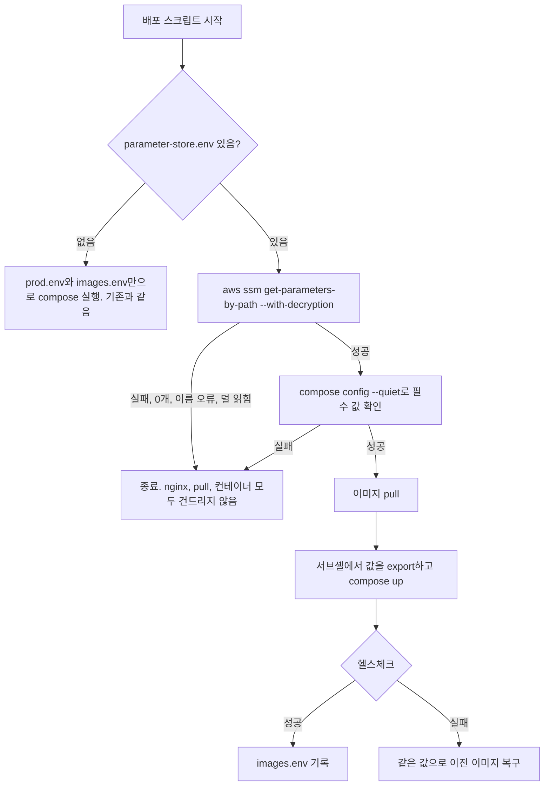

# Parameter Store 선택 경로와 이전 절차

- 상태: 구현 (2026-11-22). AWS 쪽 설정과 이전은 사용자가 한다
- 기준일: 2026-11-22 (KST)
- Linear: IKA-110
- 관련 문서: `01_secrets-inventory.md`(무엇이 비밀인지), `scripts/lib/prod-secrets.sh`, `scripts/compose-prod.sh`, `scripts/deploy-ecr-service.sh`

## 1. 무엇을 얻고 무엇은 못 얻나

지금은 운영 비밀값이 서버의 `/etc/snowthing/prod.env` 평문 파일에 있다. 이 문서는 비밀값을 AWS Systems Manager Parameter Store(SecureString, 표준 등급은 무료)에 두고 배포할 때 읽어 오는 경로를 정리한다.

얻는 것

- 값이 KMS로 암호화돼 서버 밖에 있다. 서버를 새로 만들 때 평문 파일을 복사할 일이 없다.
- 누가 언제 읽었는지 CloudTrail에 남는다. 값마다 버전이 남아 이전 값으로 되돌릴 수 있다.
- 읽을 수 있는 주체를 IAM 정책으로 정한다.
- 서버에 들어가지 않고 값을 바꿀 수 있다.

못 얻는 것

- 서버 안에서 명령이 실행되는 공격은 막지 못한다. 공격자는 인스턴스 역할로 같은 값을 읽는다. 목표는 피해를 줄이는 것이지 없애는 것이 아니다. 그래서 IMDSv2 전용과 최소 권한이 함께 있어야 한다.
- 평문이 디스크에서 완전히 사라지지 않는다. docker는 컨테이너를 만들 때 받은 환경변수를 컨테이너 설정으로 디스크에 보관한다(root 전용). `docker inspect`로도 보인다. 사라지는 것은 사람이 열어 보고 복사하는 평문 파일 하나다.
- 컨테이너 사이의 구분이 약해진다. 지금은 백엔드 컨테이너가 장악돼도 호스트의 prod.env는 읽지 못해 mcp-bot 전용 값(`OPENAI_API_KEY`)을 모른다. Parameter Store로 옮기면 백엔드 컨테이너가 인스턴스 역할(S3, RDS, SES 때문에 이미 쓰고 있다)로 경로 아래 값을 모두 읽을 수 있다. 줄이는 방법은 5.6에 적었다. 사용자가 판단할 항목이다.

## 2. 고른 방식

배포 스크립트가 시작할 때 `aws ssm get-parameters-by-path --with-decryption`으로 값을 읽고, 파일로 쓰지 않고 `docker compose` 프로세스의 환경변수로만 넘긴다.

- 켜는 조건: 서버에 `/etc/snowthing/parameter-store.env`가 있을 때만. 없으면 Parameter Store를 부르지 않고 지금과 같은 명령을 실행한다.
- 우선순위: compose는 셸 환경을 `--env-file`보다 먼저 본다. 같은 이름이 prod.env와 Parameter Store에 모두 있으면 Parameter Store 값이 쓰인다. Parameter Store에 없는 이름은 prod.env 값이 그대로 쓰인다.
- 권장 배치: 비밀만 Parameter Store, 비밀이 아닌 설정은 prod.env에 그대로 둔다.

```
/etc/snowthing/parameter-store.env   (root 소유, 644. 비밀 아님)
SNOWTHING_SSM_PARAMETER_PATH=/snowthing/prod
SNOWTHING_SSM_PARAMETER_REGION=ap-northeast-2     선택. 없으면 배포 스크립트가 받은 리전
```

이름은 경로 뒤 마지막 부분을 그대로 환경변수 이름으로 쓴다. `/snowthing/prod/SNOWTHING_KMA_SERVICE_KEY`는 `SNOWTHING_KMA_SERVICE_KEY`가 된다.

## 3. 비교한 안

### 3.1 값을 compose에 넘기는 방법

| 안 | 내용 | 장점 | 단점 | 결정 |
|---|---|---|---|---|
| A. 프로세스 환경 | 읽은 값을 서브셸에서 `export`하고 `docker compose` 실행 | 파일이 없다. env 파일 문법이 끼지 않아 `$`, `#`, 따옴표, 공백, 개행이 그대로 간다. 우선순위가 compose 기본 규칙 그대로다. 지울 파일이 없어 실패해도 남는 것이 없다 | 실행 중 root는 `/proc/<pid>/environ`으로 볼 수 있다(root는 어떤 방식이든 볼 수 있다) | 선택 |
| B. tmpfs 임시 파일 | `/run` 아래 600 파일에 env 형식으로 쓰고 `--env-file`로 넘긴 뒤 지움 | compose 명령이 단순하다 | env 파일 문법에 맞춰 값을 이스케이프해야 하고 개행 값은 따옴표 규칙이 compose 버전을 탄다. 스크립트가 중간에 죽으면 파일이 남는다. prod.env보다 뒤에 넘겨야 우선하는 등 순서 규칙이 하나 더 생긴다 | 버림 |
| C. 애플리케이션이 직접 읽기 | 백엔드와 mcp-bot이 기동할 때 SDK로 Parameter Store를 읽음 | 컨테이너 설정에도 값이 남지 않는다 | 백엔드와 mcp-bot(다른 저장소) 코드와 의존성을 바꿔야 한다. 기동이 Parameter Store 가용성에 묶여 재시작 정책이나 재부팅 때 AWS 호출이 실패하면 서비스가 뜨지 않는다 | 버림. 이번 범위는 코드 변경 없음 |
| D. 서버 파일로 동기화 | 읽은 값을 `/etc/snowthing/secrets.env`에 저장 | 손으로 띄우기 쉽다 | 평문 파일이 그대로 남아 옮기는 의미가 없다 | 버림 |

### 3.2 켜는 스위치를 어디에 두나

| 안 | 장점 | 단점 | 결정 |
|---|---|---|---|
| 서버의 설정 파일 | 배포, 롤백, 손으로 띄우기가 모두 같은 파일을 본다. 워크플로와 SSM 명령이 바뀌지 않는다. 파일을 지우면 꺼진다 | 서버에 파일 하나를 만들어야 한다 | 선택 |
| 스크립트 인자(GitHub 변수) | 서버에 파일이 없다 | 배포 2곳과 롤백 3곳의 SSM 명령을 모두 고쳐야 하고, 과거 커밋으로 롤백하면 그 시점 워크플로가 인자를 넘기지 않는다. 손으로 띄울 때 경로를 외워야 한다 | 버림 |

## 4. 동작



- 페이지: Parameter Store는 한 번에 10개까지만 준다. aws CLI가 `NextToken`을 따라가며 끝까지 읽어 한 JSON으로 합친다. 응답에 `NextToken`이 남아 있으면 덜 읽은 것으로 보고 실패시킨다.
- 이름 검사: 대문자, 숫자, 밑줄이 아닌 이름이 하나라도 있으면 실패. `compose.prod.yml`이 보간하지 않는 이름과 `*_IMAGE_URI`는 건너뛰고 이름만 경고로 남긴다(과거 커밋으로 롤백할 때 그 시점 compose에 없는 이름이 있어도 배포가 되게).
- 일부만 읽힌 상태 방지: 읽기, 해석, 이름 검사를 모두 통과한 뒤에만 값 목록을 채운다. 하나라도 실패하면 목록은 비어 있고 스크립트는 `set -e`로 끝난다.
- 출력: 읽은 개수와 건너뛴 이름만 출력한다. 값은 출력하지 않는다. `set -x`로 실행해도 값을 다루는 함수 안에서는 추적을 끈다. aws 오류 원문(계정 ID가 든 ARN이 나올 수 있다)은 Actions 로그로 가지 않게 서버의 `/var/log/snowthing-deploy/parameter-store-error.log`(600)에만 남긴다.
- SSM send-command: 워크플로가 보내는 명령은 바뀌지 않았다. 값은 서버 안에서만 읽히고 명령 인자에 실리지 않는다.
- 롤백: 워크플로의 롤백도 같은 스크립트를 부르므로 같은 값을 쓴다. 스크립트 안의 자동 복구(이전 이미지로 되돌리기)도 이미 읽어 둔 값으로 한다.
- 마이그레이션 실행기(`scripts/run-production-migrations.sh`)는 건드리지 않았다. DB 인증은 그대로 IAM이다.

### 4.1 재시작, 재부팅, 손으로 띄우기

| 상황 | 값이 어디서 오나 | Parameter Store가 필요한가 |
|---|---|---|
| 컨테이너가 죽어 `restart: unless-stopped`로 다시 뜸 | 컨테이너를 만들 때 받은 환경변수(docker가 보관) | 아니오 |
| 서버 재부팅 | 위와 같다 | 아니오. AWS 장애 중에도 뜬다 |
| 배포, 롤백 | 스크립트가 다시 읽는다 | 예. 읽지 못하면 배포만 실패하고 실행 중인 서비스는 그대로다 |
| 손으로 컨테이너를 다시 만듦 | `scripts/compose-prod.sh`가 같은 방식으로 읽는다 | 예 |

손으로 띄울 때는 아래만 쓴다. prod.env, images.env, Parameter Store 값을 배포 스크립트와 같은 순서로 넘긴다.

```bash
cd /home/ubuntu/snowthing
sudo AWS_REGION=<리전> scripts/compose-prod.sh up -d            # 전체를 지금 값으로 맞춤
sudo AWS_REGION=<리전> scripts/compose-prod.sh up -d backend    # 한 서비스만
sudo AWS_REGION=<리전> scripts/compose-prod.sh config --quiet   # 값이 다 채워지는지만 확인
```

비밀을 prod.env에서 지운 뒤에 예전 명령(`docker compose --env-file /etc/snowthing/prod.env ... up -d`)을 그대로 쓰면 안 된다. 필수 네 값은 compose가 막아 주지만 나머지 비밀은 빈 값으로 컨테이너가 다시 만들어진다(`01_secrets-inventory.md` 7절).

값만 바꾼 경우에는 배포가 없어도 `compose-prod.sh up -d <서비스>`를 실행해야 반영된다. compose는 환경변수가 달라진 컨테이너만 다시 만든다. 값이 같으면 아무것도 다시 만들지 않는다.

## 5. 이전 절차 (사용자가 AWS에서 할 일)

명령의 `<...>`는 자리표시다. 실제 값으로 바꿔서 쓰고 문서나 PR에는 적지 않는다.

### 5.1 미리 확인

```bash
# 서버에서
python3 --version                       # 응답 해석에 쓴다. 없으면 설치
aws --version                           # v2 권장
sudo stat -c '%U:%G %a %n' /etc/snowthing/*     # prod.env와 migration.env는 root:root 600이어야 한다
sudo chown root:root /etc/snowthing/prod.env && sudo chmod 600 /etc/snowthing/prod.env   # 다르면

# 내 PC나 CloudShell에서: IMDSv2 전용인지
aws ec2 describe-instances --instance-ids <인스턴스 ID> \
  --query 'Reservations[].Instances[].MetadataOptions'
# HttpTokens가 required여야 한다. optional이면:
aws ec2 modify-instance-metadata-options --instance-id <인스턴스 ID> --http-tokens required
```

`HttpPutResponseHopLimit`은 낮추지 않는다. 백엔드 컨테이너가 브리지 네트워크에서 인스턴스 역할을 쓰고 있어 1로 내리면 S3, RDS 인증이 끊긴다.

### 5.2 이 PR을 먼저 배포

설정 파일이 없는 상태로 한 번 배포해 지금과 똑같이 도는지 본다. 배포 로그에 "Parameter Store에서"로 시작하는 줄이 없어야 한다.

### 5.3 인스턴스 역할에 읽기 권한 추가

EC2 인스턴스 프로필의 역할에 아래 정책을 붙인다. 배포용 OIDC 역할에는 붙이지 않는다(값은 서버 안에서만 읽는다).

```json
{
  "Version": "2012-10-17",
  "Statement": [
    {
      "Sid": "ReadSnowthingProdParameters",
      "Effect": "Allow",
      "Action": "ssm:GetParametersByPath",
      "Resource": [
        "arn:aws:ssm:<리전>:<계정 ID>:parameter/snowthing/prod",
        "arn:aws:ssm:<리전>:<계정 ID>:parameter/snowthing/prod/*"
      ]
    },
    {
      "Sid": "DecryptOnlyThroughParameterStore",
      "Effect": "Allow",
      "Action": "kms:Decrypt",
      "Resource": "arn:aws:kms:<리전>:<계정 ID>:key/<KMS 키 ID>",
      "Condition": {
        "StringEquals": { "kms:ViaService": "ssm.<리전>.amazonaws.com" }
      }
    }
  ]
}
```

- 쓰기(`PutParameter`, `DeleteParameter`)와 `ssm:DescribeParameters`는 주지 않는다. 서버는 읽기만 한다.
- 기본 키(`alias/aws/ssm`, 월 요금 없음)를 쓰면 두 번째 문장 없이도 되는 것으로 알고 있다(키 정책이 같은 계정의 Parameter Store 경유 사용을 허용). 이 부분은 실제 계정에서 확인하지 못했다. 5.5의 확인 명령이 권한 오류를 내면 두 번째 문장을 넣는다. 직접 만든 키(월 약 1달러)를 쓰면 두 번째 문장이 필요하다.
- 꼭 확인할 것: SSM send-command를 쓰려면 역할에 `AmazonSSMManagedInstanceCore` 관리형 정책이 붙어 있을 텐데, 이 정책은 `ssm:GetParameter`, `ssm:GetParameters`를 모든 리소스에 허용하는 것으로 알고 있다(IAM 콘솔에서 정책 내용을 직접 확인한다). 그렇다면 이 서버는 이름을 아는 파라미터를 이미 읽을 수 있고, 위 정책은 경로 단위 읽기를 더할 뿐 범위를 좁히지 못한다. 좁히려면 아래 거부 문장을 함께 넣는다. 이 서버에서 다른 파라미터를 읽는 기능(CloudWatch 에이전트 설정 등)이 없을 때만 넣는다.

```json
{
  "Sid": "DenyParametersOutsideSnowthingProd",
  "Effect": "Deny",
  "Action": ["ssm:GetParameter", "ssm:GetParameters", "ssm:GetParametersByPath", "ssm:GetParameterHistory"],
  "NotResource": [
    "arn:aws:ssm:<리전>:<계정 ID>:parameter/snowthing/prod",
    "arn:aws:ssm:<리전>:<계정 ID>:parameter/snowthing/prod/*"
  ]
}
```

### 5.4 값 넣기

콘솔(Systems Manager, Parameter Store, 파라미터 생성)에서 넣으면 셸 이력이 남지 않는다. 유형은 SecureString, 등급은 표준.

명령으로 넣을 때는 값을 명령줄에 직접 쓰지 않는다. CloudShell(bash)에서:

```bash
IFS= read -rs -p '값: ' VALUE && echo
aws ssm put-parameter --name /snowthing/prod/<이름> --type SecureString --value "$VALUE" >/dev/null
unset VALUE
```

- `read -s`는 입력을 화면과 이력에 남기지 않는다. `IFS=`와 `-r`은 앞뒤 공백과 역슬래시를 지키게 한다.
- 이미 있는 값을 바꿀 때는 `--overwrite`를 붙인다.
- aws CLI v1은 `https://`로 시작하는 값을 주소로 보고 내용을 받아 오려 한다. Discord 웹훅 주소가 여기에 걸린다. v2(CloudShell 기본)를 쓴다.
- 값은 ASCII만 쓴다. 서버 로캘에 따라 ASCII 밖의 글자가 든 응답을 해석하지 못할 수 있다. 그 경우 배포는 시작 전에 실패한다.
- prod.env의 값이 따옴표로 감싸져 있으면 따옴표는 빼고 넣는다. compose는 env 파일의 감싼 따옴표를 벗기지만 Parameter Store 값은 글자 그대로 쓴다.

### 5.5 하나씩 옮기는 순서

1. 영향이 작은 값 하나부터 넣는다(예: `DISCORD_WEBHOOK_EVENT`). prod.env의 줄은 지우지 않는다.
2. 서버에 설정 파일을 만든다.
   ```bash
   echo 'SNOWTHING_SSM_PARAMETER_PATH=/snowthing/prod' | sudo tee /etc/snowthing/parameter-store.env >/dev/null
   sudo chmod 644 /etc/snowthing/parameter-store.env
   ```
3. 읽히는지 확인한다. 컨테이너를 건드리지 않는다.
   ```bash
   cd /home/ubuntu/snowthing
   sudo AWS_REGION=<리전> scripts/compose-prod.sh config --quiet
   # "Parameter Store에서 1개 값을 읽었습니다"가 나오면 권한과 경로가 맞다.
   ```
4. 넣은 값이 지금 컨테이너가 쓰는 값과 같은지 값을 보지 않고 확인한다.
   ```bash
   sudo docker exec snowthing-backend printenv <이름> | sha256sum
   aws ssm get-parameter --name /snowthing/prod/<이름> --with-decryption \
     --query Parameter.Value --output text | sha256sum
   # 두 해시가 같아야 한다. (get-parameter 권한이 있는 내 PC나 CloudShell에서)
   ```
5. 다음 배포 로그에서 "Parameter Store에서 N개 값을 읽었습니다"를 확인한다. 값이 같으면 컨테이너 동작은 달라지지 않는다.
6. 나머지를 같은 방법으로 옮긴다. 권장 순서: Discord 웹훅, 공공 API 키(`SNOWTHING_KMA_SERVICE_KEY`, `SNOWTHING_OPINET_API_KEY`), 소셜 로그인 시크릿, 봇 비밀 둘, `WEB_PUSH_VAPID_PRIVATE_KEY`, `SNOWTHING_EMAIL_VERIFICATION_SECRET`, 마지막에 `OPENAI_API_KEY`(5.6을 읽고 정한다).
7. 건너뛴 이름 경고가 나오면 이름을 잘못 넣은 것이다. `compose.prod.yml`에 있는 이름과 글자가 같아야 한다.

### 5.6 `OPENAI_API_KEY`를 옮길지

1절의 세 번째 한계 때문에 이 값은 선택이다.

- 옮긴다: 평문 파일이 완전히 비워진다. 대신 백엔드 컨테이너가 장악되면 이 키도 읽힌다. OpenAI 쪽에서 프로젝트 전용 키와 월 지출 한도를 걸어 피해 상한을 둔다.
- 옮기지 않는다: 이 키만 prod.env에 남는다. 백엔드 컨테이너에서는 읽을 수 없다. 서버 root가 뚫리면 어느 쪽이든 읽힌다.

### 5.7 prod.env에서 비밀을 지우는 시점

아래가 모두 맞을 때 지운다.

- 옮길 비밀이 모두 Parameter Store에 있고 4번의 해시가 모두 같다.
- 설정 파일이 있는 상태로 백엔드와 프론트 배포가 각각 한 번 이상 성공했다.
- 롤백할 가능성이 있는 release, stable 태그가 모두 이 변경 이후 커밋이다. 그 전 커밋의 배포 스크립트는 Parameter Store를 읽지 않아, 그 커밋으로 롤백하면 prod.env에 비밀이 있어야 한다.

지울 때는 비밀 줄만 지우고 설정값은 남긴다. 백업 사본을 만들면 평문 파일이 하나 더 생기므로 만들지 않는다(값은 Parameter Store에 버전으로 남아 있다). 지운 뒤 `sudo AWS_REGION=<리전> scripts/compose-prod.sh config --quiet`가 성공하는지 본다.

### 5.8 되돌리기

- 끄기: `sudo rm /etc/snowthing/parameter-store.env`. 다음 실행부터 prod.env만 쓴다. 실행 중인 컨테이너는 그대로다.
- prod.env에서 이미 비밀을 지웠다면 끄기 전에 값을 prod.env에 다시 넣는다. 넣지 않고 끄면 필수 값이 없어 배포가 시작 전에 실패하거나(네 값), 나머지 비밀이 빈 채로 뜬다.
- 값 하나를 이전 값으로: `aws ssm get-parameter-history --name <이름> --with-decryption`으로 이전 버전을 확인하고 다시 넣은 뒤 `compose-prod.sh up -d <서비스>`.
- 읽기 실패로 배포가 막혔을 때: 서버의 `/var/log/snowthing-deploy/parameter-store-error.log`를 본다. 급하면 위의 끄기로 prod.env 경로로 돌아간다(비밀이 아직 prod.env에 있을 때).

## 6. 영향 범위

| 항목 | 영향 |
|---|---|
| 설정 파일이 없는 서버 | 없음. aws ssm을 부르지 않고 compose에 넘기는 인자와 환경이 기존과 같다 |
| 백엔드, 프론트 코드 | 변경 없음 |
| 워크플로 | 배포 경로 필터에 `scripts/lib/prod-secrets.sh`를 추가했다. SSM 명령은 그대로다 |
| 배포 시간 | 설정이 있으면 aws 호출 1회(페이지 수만큼 요청)와 `compose config` 1회가 늘어난다 |
| 장애 | Parameter Store를 읽지 못하면 새 배포와 롤백이 막힌다. 실행 중인 서비스와 재시작은 영향이 없다 |
| 비용 | 표준 파라미터와 기본 KMS 키는 월 요금이 없다. KMS 요청은 무료 한도(월 2만 건) 안이다. 직접 만든 키를 쓰면 월 약 1달러 |
| 머지할 때 | `scripts/deploy-ecr-service.sh`와 `compose.prod.yml`이 바뀌어 백엔드, 프론트 배포 워크플로가 모두 돈다 |

## 7. 검증하지 못한 것

- 실제 AWS 계정에서의 읽기, IAM 정책, KMS 권한. 로컬에서는 가짜 aws 명령과 로컬 가짜 SSM 엔드포인트로만 확인했다.
- 운영 서버의 python3, aws CLI 버전, IMDS 설정, prod.env 권한. 5.1의 명령으로 확인한다.
- 리눅스에서 ASCII 밖의 값이 든 응답 처리. 그래서 값은 ASCII로 제한했다.
