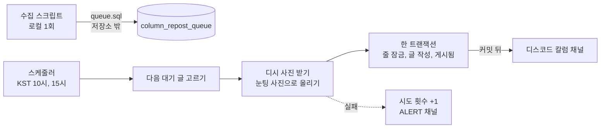

# 휘구리 칼럼 예약 게시 (IKA-112, 2026-11-24)

## 왜

- 디시인사이드 스노보드 마이너 갤러리의 고정닉 휘구리가 칼럼 탭에 쓴 강좌와 장비 글을 눈팅 정보게시판으로 옮긴다.
- 원작자에게 허락을 받았다. 닉네임 "휘구리"를 그대로 써도 된다고 했고, 출처 표시 방식은 원작자가 정한 대로 따로 붙이지 않는다.
- 운영자가 눈팅에 휘구리 계정을 만들었다. 계정 이메일은 운영 설정에만 둔다.

## 범위

- 포함: 칼럼 탭(말머리 130)의 휘구리 글 44개(2022-08 ~ 2026-11)를 오래된 글부터 매일 KST 10시, 15시에 하나씩 정보게시판(`INFO`)에 올린다. 22일이면 끝난다. 올릴 때마다 전용 디스코드 채널로 알린다. 게시글 본문의 유튜브 주소를 플레이어로 보여 준다(모든 글).
- 제외: 휘구리가 앞으로 쓸 새 글의 자동 수집, 칼럼 탭 밖의 글, 디시 자체 영상 복사와 게시글 동영상 기능, 원문 작성일 표시(게시 날짜는 실제로 올라간 시각).

## 흐름

## 1. 수집 (scripts/column_repost/collect.py)

- 고르는 기준은 고정닉 ID(`data-uid=wwwmskim97`)다. 닉네임은 누구나 같게 쓸 수 있어 닉네임으로 고르면 사칭 글이 섞인다.
- 디시는 연달아 15번쯤 요청하면 빈 응답을 준다(조사 중 실제로 겪음). 글 사이를 25초 쉬고, 받은 원문 HTML을 작업 폴더에 남겨 막혀서 멈춰도 다시 실행하면 이어서 받는다.
- 본문 변환(HTML에서 마크다운)
  - 줄 하나가 문단 하나. 빈 줄은 합친다. 마크다운 기호는 글자로 이스케이프한다.
  - 사진: 디시 주소 그대로 ``로 둔다. 바꾸는 일은 게시할 때 한다(아래 2).
  - 유튜브(임베드, 링크, 주소 글자): `https://www.youtube.com/watch?v=ID` 한 줄로 둔다. 화면이 플레이어로 바꾼다(아래 4).
  - 디시 자체 영상(`movie_view`): "▶ 영상은 원문에서 보기" 원문 링크로 바꾼다. 영상 주소에 디시 서명 키가 붙어 있어 오래 재생되지 않는다.
  - 디시 앱 서명 줄("- dc official App")은 뺀다.
- 결과: `queue.sql`(INSERT IGNORE, 오래된 글부터 순번)과 `preview.md`(검토용). 원작자 글이라 공개 저장소에 커밋하지 않는다. 스크립트는 작업 폴더가 저장소 안이면 멈춘다.

## 2. 사진은 게시하는 순간 올린다

- 눈팅에 올린 사진은 업로드 기록(`post_image_upload`)이 남고, 1시간 안에 글에 붙지 않으면 정리된다(`PostImageLifecycleService`). 미리 올려 두면 22일을 기다리는 동안 지워진다.
- 그래서 게시 시각에 백엔드가 그 글의 디시 사진을 받아(`DcImageFetcher`) 회원 업로드와 같은 경로(`ImageService.preparePostImage` → `PostImageLifecycleService.upload`, 주인은 휘구리 이메일)로 올리고 곧바로 글을 쓴다. 크기 조정, 형식 검사, 글 삭제 시 사진 정리가 일반 글과 같다.
- 디시는 다른 사이트에서 사진을 바로 불러오면 막는다. 원문 글 주소를 Referer로 붙인다.
- 서버가 임의 주소로 요청하지 않도록 `https`, `dcimg숫자` 또는 `image` + `.dcinside.com`/`.co.kr`, 기본 포트, 사용자 정보 없음만 허용하고 리다이렉트를 따라가지 않는다. 한 장 5MB(회원 업로드 상한)를 넘으면 읽기를 멈춘다.
- 눈팅이 받지 않는 형식(gif), 5MB 초과, 너무 큰 해상도는 "사진은 원문에서 보기" 원문 링크로 바꾼다. 받기 자체가 실패하면(네트워크) 그 글 게시를 실패로 처리한다.
- 고르지 않은 안: 로컬에서 S3 다른 경로에 미리 올리기. 업로드 정리 규칙 밖이라 글을 지워도 사진이 남고, 로컬 AWS 권한으로 운영 버킷에 직접 써야 한다.

## 3. 예약 게시 (backend `domain/columnrepost`)

### 대기열 표 `column_repost_queue` (065)

| 칸 | 뜻 |
|---|---|
| `sequence_no` UNIQUE | 게시 순서(오래된 원문부터) |
| `source_no` UNIQUE | 디시 원문 번호. 같은 글이 두 번 들어가지 않는다 |
| `title`, `content` | 제목, 마크다운 본문(사진은 디시 주소) |
| `status` | `PENDING`, `PUBLISHED` |
| `post_public_id`, `published_at` | 게시된 글과 시각 |
| `attempts`, `last_error` | 실패 횟수와 마지막 오류 |

- 인덱스 `(status, sequence_no)`: 다음 대기 글 찾기.
- 본문을 저장소에 두지 않으려고 줄은 마이그레이션이 아니라 `queue.sql`로 운영 DB에 넣는다.

### 게시 한 번

1. `status=PENDING` 중 `sequence_no`가 가장 작은 줄을 고른다. 없으면 끝(아무것도 안 함).
2. 그 줄의 `attempts`가 상한(3)에 닿았으면 멈춘다. 순서를 지키려고 다음 글로 건너뛰지 않는다. 운영자가 고치고 `attempts`를 0으로 되돌리면 다시 간다.
3. 사진을 올리고 본문 주소를 바꾼다(트랜잭션 밖, 네트워크).
4. 한 트랜잭션에서 줄을 `SELECT ... FOR UPDATE`로 잠그고 아직 `PENDING`인지 다시 본다. 그렇다면 `PostService.createPost`로 휘구리 계정 글을 쓰고 `PUBLISHED`로 바꾼다. 같은 시각에 두 번 불려도 두 번째는 잠금 뒤 확인에서 빠진다.
5. 커밋된 뒤에만(`AFTER_COMMIT`) 칼럼 채널로 "📚 휘구리 칼럼 12/44 게시, 제목, 링크"를 보낸다.

- 실패(사진 받기, 계정 없음, 글 작성 검증): 새 트랜잭션에서 `attempts`를 올리고 오류를 남긴 뒤 ALERT 채널로 알린다. 다음 게시 시각에 같은 글을 다시 시도한다.
- 사진은 3에서 올렸는데 4에서 빠지면(다른 실행이 먼저 게시) 그 사진은 1시간 뒤 기존 정리 작업이 지운다.
- 글은 일반 회원 글과 같은 경로를 탄다. 금칙어 보류(IKA-96), AI 검열 대기열, 검색 색인이 그대로 적용된다. 작성 IP는 남기지 않는다(서버 작업).
- 게시 시각과 글 날짜: 실제로 올라간 시각이다.

### 설정

| 이름 | 기본값 | 뜻 |
|---|---|---|
| `SNOWTHING_COLUMN_REPOST_ENABLED` | `false` | 스케줄러 켜기 |
| `SNOWTHING_COLUMN_REPOST_MEMBER_EMAIL` | 빈 값 | 휘구리 계정 이메일 |
| `DISCORD_WEBHOOK_COLUMN` | 빈 값 | 칼럼 게시 알림 채널(비면 게시 알림만 꺼짐) |
| `snowthing.column-repost.cron` | `0 0 10,15 * * *` (KST) | 게시 시각 |
| `snowthing.column-repost.category-code` | `INFO` | 게시판 |
| `snowthing.column-repost.max-attempts` | `3` | 한 글의 실패 상한 |

- 운영 값은 `prod.env`에 넣고 `compose.prod.yml`이 넘긴다. 웹훅 주소는 비밀값이라 저장소에 두지 않는다.
- 회원은 ID 대신 이메일로 찾는다. 운영자가 알려 준 값이 이메일이고, 로그인 아이디와 같아 확인하기 쉽다.

## 4. 유튜브 플레이어 (frontend)

- 본문 HTML 정화(`sanitizeHtml.ts`)는 지금처럼 iframe을 막는다. 글쓴이가 쓴 iframe은 그대로 통과하지 않는다.
- 정화가 끝난 뒤 브라우저에서(`ToastViewer` → `embedYoutubeLinks`) 문단 전체가 유튜브 주소 한 줄인 경우만 `youtube-nocookie.com/embed/{ID}` 플레이어로 바꾼다. ID는 11자 영문, 숫자, `-`, `_`만 받는다. 시작 시간(`t`, `start`)은 초로 넘긴다.
- 문장 안에 섞인 유튜브 링크, 글자가 주소와 다른 링크는 그대로 링크로 둔다.
- 모든 글에 적용된다. 회원이 유튜브 주소를 한 줄로 쓴 기존 글도 플레이어로 보인다.
- 서버가 먼저 넣어 주는 본문 HTML(SEO용)에는 주소 글자로 남고, 브라우저 뷰어가 그리면서 플레이어로 바뀐다.

## 5. 운영 순서

1. 운영 DB에 065 마이그레이션 적용.
2. 새 이미지 배포.
3. `queue.sql`을 운영 DB에 넣고 44줄, 순번을 확인한다.
4. `prod.env`에 휘구리 이메일, 칼럼 웹훅, `SNOWTHING_COLUMN_REPOST_ENABLED=true`를 넣고 백엔드를 다시 만든다.
5. 다음 10시 또는 15시에 첫 글과 디스코드 알림을 확인한다.

1, 3, 4는 운영 변경이라 실행 전에 사용자 확인을 받는다.

## 6. 리스크

- 디시 사진 주소가 바뀌거나 막히면 그 글이 실패한다. ALERT로 알리고 3번 실패하면 멈춘다. 그 줄의 본문에서 사진 주소를 빼거나 고치고 `attempts`를 0으로 되돌리면 이어서 간다.
- 2022년 글처럼 오래된 장비, 가격 이야기가 그대로 올라간다(사용자 확인함).
- 같은 계정이 하루 두 번 긴 글을 쓰므로 AI 검열 대기열에 들어간다. 검열이 보류하면 글이 숨는다. 첫 며칠 게시 상태를 확인한다.
